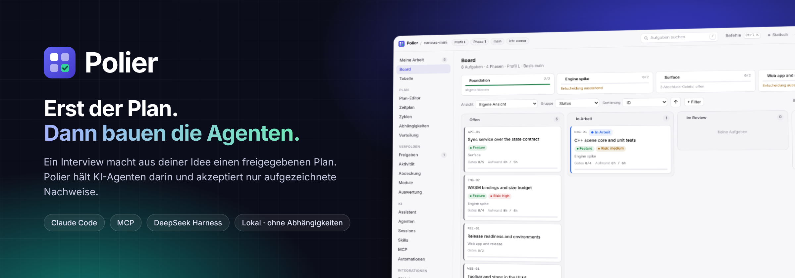
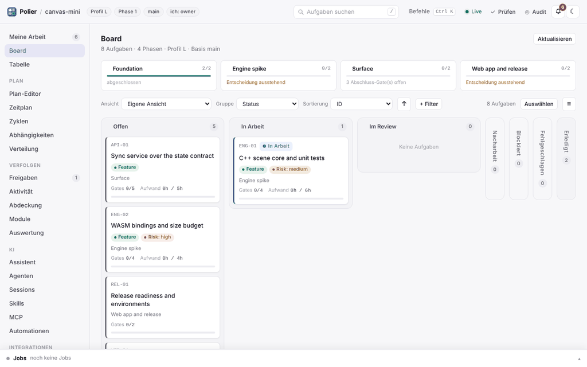
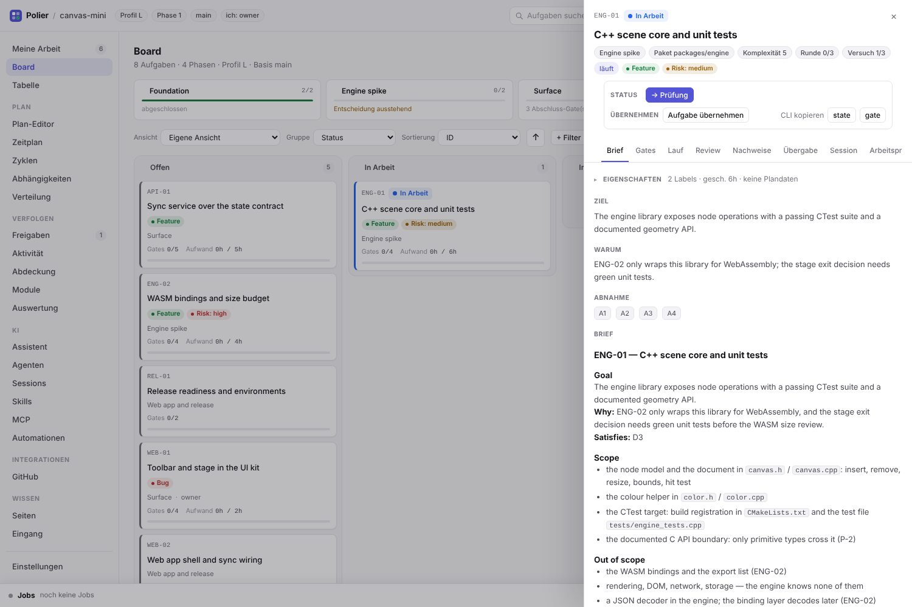
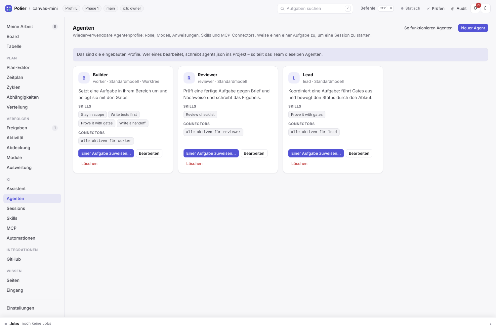
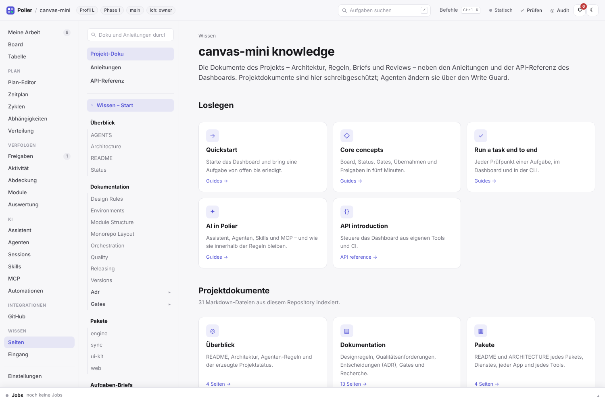
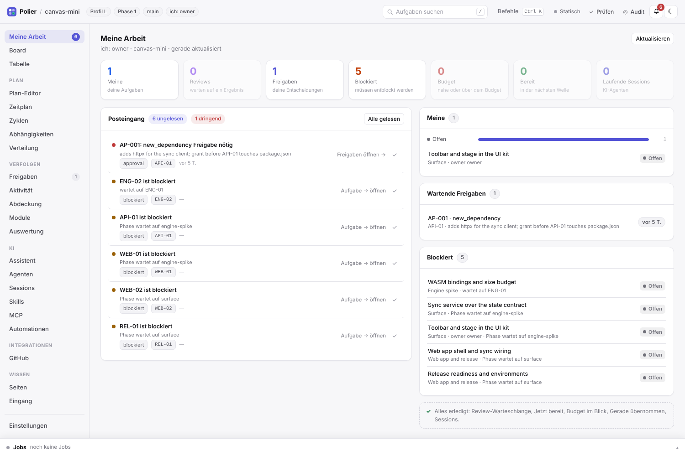

<p align="center">
  
</p>

<p align="center">
  <a href="https://github.com/atshv/Polier/releases"></a>
  <a href="https://github.com/atshv/Polier/actions/workflows/test.yml"></a>
  
  
  
</p>

<p align="center"><a href="README.md">English</a> · <b>Deutsch</b></p>

**Polier ist der Bauleiter für KI-Programmieragenten.** Du beschreibst, was du willst; Polier stellt Fragen und schreibt eine einseitige Architektur und einen Aufgabenplan mit erlaubten Dateien, Abnahmekriterien und Prüfungen. Nach deiner Freigabe bauen Agenten Aufgabe für Aufgabe – und Polier blockiert jeden Schreibzugriff außerhalb der aktuellen Aufgabe, akzeptiert nur aufgezeichnete Testläufe als Nachweis und protokolliert jeden Versuch, jede Freigabe und jedes Review.

Funktioniert mit **Claude Code**, jedem **MCP**-Client und **DeepSeek Harness**. Nur Python-Standardbibliothek, alles bleibt als Dateien in deinem Repository.

<p align="center"></p>

## Warum

| Ohne Polier | Mit Polier |
|---|---|
| Ein Agent „repariert schnell“ Dateien einer anderen Aufgabe | Schreibzugriffe außerhalb des Aufgabenbereichs werden blockiert |
| „Tests laufen“ ist ein Satz im Chat | Es zählt nur ein aufgezeichneter Gate-Lauf mit Exit-Code und Log-Prüfsumme |
| Aufgaben starten, bevor ihre Grundlage fertig ist | `in_progress` wird abgelehnt, solange eine Abhängigkeit offen ist |
| Ein festgefahrener Agent versucht es endlos | Versuche und Token-Budget sind begrenzt, dann wird eskaliert |
| Später weiß niemand, warum etwas entschieden wurde | Läufe, Freigaben und Reviews werden mit der Aufgabe committet |

## Schnellstart

```bash
git clone https://github.com/atshv/Polier.git && cd Polier
./install.sh claude          # Claude Code; für DeepSeek Harness: dsh plugin --profile <name> add .
```

Dann in einem leeren Ordner eine Session öffnen und schreiben: *„Plane ein neues Projekt: …“* – Polier stellt seine Fragen, zeigt den Plan zur Freigabe und legt die Projektdateien an. Das Dashboard ist optional:

```bash
python3 tools/serve.py /pfad/zum/projekt --open      # zum Ausprobieren: examples/monorepo-mini
```

Die Oberfläche folgt der Browsersprache; umschalten unter **Einstellungen → Sprache**, in der Befehlspalette (Strg/Cmd+K) oder mit `?lang=de`. Hooks für Claude Code: [`adapters/claude-code/README.md`](adapters/claude-code/README.md).

## Nachweise statt Versprechen

<p align="center"></p>

1. **Planen** – Interview → `ARCHITECTURE.md`, `board.json`, Aufgaben-Briefs, `policy.json`. Du gibst frei.
2. **Bauen** – ein Agent übernimmt eine Aufgabe und darf nur in ihrem Bereich schreiben.
3. **Nachweisen** – jedes Gate läuft über Polier und hinterlässt einen Eintrag mit Prüfsumme.
4. **Prüfen** – `done` braucht ein bestandenes Review, die Gate-Nachweise und eine Übergabe.

## Was drin ist

| | |
|---|---|
| **Leitplanken** | Write Guard, Prüfpunkte, Übernahmen, Freigaben, Token-Budgets – in `core/`, für alle Zugänge gleich |
| **Dashboard** | Board, Tabelle, Zeitplan, Zyklen, Abdeckung, Auswertung, Freigaben, Posteingang, Befehlspalette – **auf Deutsch und Englisch** |
| **KI** | Assistent mit bestätigten Vorschlägen, Agentenprofile, Skills, MCP-Server und -Connectors, GitHub-Login |
| **Wissen** | Projektdokumente als Doku-Seite, dazu ein eingebautes Handbuch und eine API-Referenz (Englisch) |
| **CLI** | 31 Werkzeuge mit denselben Regeln, von `state.py` bis `mcp.py` – siehe [Cheatsheet](guide/cheatsheet.md) |

<table>
  <tr>
    <td width="50%"></td>
    <td width="50%"></td>
  </tr>
  <tr>
    <td></td>
    <td></td>
  </tr>
</table>

## Mehr erfahren

- **Dashboard & API** – [`docs/dashboard.md`](docs/dashboard.md) oder im Dashboard unter *Seiten → Anleitungen / API-Referenz* (Englisch)
- **Eigenen KI-Client verbinden** – `claude mcp add polier -- python3 tools/mcp.py --root <projekt> --read-only`
- **Grenzen** – Polier ist keine Sandbox: [was der Write Guard nicht abdeckt](docs/guard-limits.md) (Englisch)
- **Änderungen** – [`CHANGELOG.md`](CHANGELOG.md) · [Releases](https://github.com/atshv/Polier/releases)

Tests: `npm install && npm test`. Lizenz: [MIT](LICENSE).
