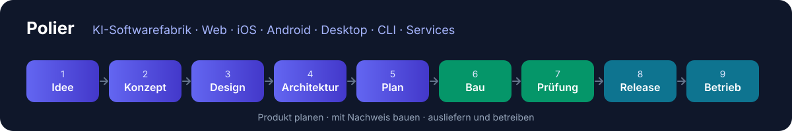

<p align="center">
  
</p>

<p align="center">
  <a href="https://github.com/atshv/Polier/releases"></a>
  <a href="https://github.com/atshv/Polier/actions/workflows/test.yml"></a>
  
  
  
  
</p>

<p align="center"><a href="README.md">English</a> · <b>Deutsch</b></p>

**Polier ist eine KI-Softwarefabrik für DeepSeek Harness und Claude Code.** Du beschreibst das Produkt, Polier führt es durch neun Stationen – Idee, Konzept, Design, Architektur, Plan, Bau, Prüfung, Release, Betrieb. Egal ob Website, iOS- oder Android-App, Desktop-App, CLI oder Backend-Service. An jeder Station weiss Polier, was dein Produkt braucht (Registrierung, Zahlungen, Offline-Modus, Datenschutzerklärung, App-Store-Datenschutzangaben, geschlossener Play-Test, Signierung, Monitoring …), verlangt Nachweise und schliesst die Station erst mit deiner Freigabe.

## Installieren

**DeepSeek Harness**

```bash
dsh plugin --profile web add github:atshv/polier
```

DSH neu starten (oder *dsh-polier* unter **Plugins** einschalten).

**Claude Code**

```text
/plugin marketplace add atshv/polier
/plugin install polier@polier
```

Oder in einem Schritt: `/plugin install polier --marketplace atshv/Polier`. Danach die Session neu starten. Du bekommst die `pl_*`-Tools, den Live-Kontext, Write Guard und Stop-Check als Hooks, einen Subagent pro Fachrolle (`polier:frontend-builder`, `polier:reviewer` …) und den Skill `polier` ([`prompt/claude-code.md`](prompt/claude-code.md), Englisch).

Python 3.9+ (für Claude Code auch Node 20+) muss vorhanden sein, sonst wird nichts installiert.

## Keine Befehle

In einem leeren Ordner eine Session öffnen und sagen, was du willst, z. B. *„Baue mit Polier eine App, die …“*. Ab dann redest du einfach.

| Du sagst | Was passiert |
|---|---|
| „Ist alles bereit?“ | Der Agent ruft `pl_preflight` auf und prüft Python, Git, Harness, Write Guard und Projekt. Jedes Problem kommt mit der Lösung |
| „Was fehlt noch?“ | Der Agent sieht den Live-Block `<polier>` schon – Station, offene Punkte, laufende Aufgabe, nächster Schritt |
| „Schliess die Station.“ | Du bekommst eine Freigabeabfrage (in Claude Code einen Dialog), nur deine Antwort schliesst sie |
| „Übernimm Aufgabe M03.“ | Die Session bindet die Aufgabe, reserviert sie und darf nur noch in ihrem Bereich schreiben |
| „Wir brauchen die Bibliothek httpx.“ | Eine Freigabeabfrage, die Antwort landet in `reviews/approvals/` |
| „Plane die nächste Etappe.“ | Die Session fragt nach dem Lead-Modus – wieder eine Abfrage, die du beantwortest |

Ein „ja“ im Chat ändert nichts. Entscheidungen sind Freigabeabfragen, Einträge schreiben die Tools, `STATUS.md` und `docs/factory.md` erneuern sich selbst.

## Die Linie

| # | Station | Ergebnis | Beispiele, was geprüft wird |
|---|---|---|---|
| 1 | Idee | `project-input.md`, `factory.json` | Problem, Nutzer, Erfolgssignal, Abgrenzung, Plattformen |
| 2 | Konzept | `docs/concept.md` | MVP-Funktionen, User Stories, Abnahmeszenarien, Kosten, Rechtsrahmen |
| 3 | Design | `docs/ux-flows.md`, `docs/design-rules.md` | Abläufe, Screens, Tokens, Zustände, Barrierefreiheit, Plattform-Richtlinien |
| 4 | Architektur | `ARCHITECTURE.md`, ADRs | Stack mit Quellen, Schichten, Datenmodell, API, Secrets, Umgebungen |
| 5 | Plan | `board.json`, `policy.json`, Briefs | jeder Bau- und Prüfpunkt hat eine Aufgabe, Gates, Kaltstart-Test |
| 6 | Bau | Code, `runs/`, `reviews/` | Login, Daten, Sicherheit, Zahlungen, Push, Berechtigungen, Privacy Manifest |
| 7 | Prüfung | Gate-Nachweise | E2E, Geräte-/Browser-Matrix, Barrierefreiheit, OWASP/MASVS, Beta |
| 8 | Release | `docs/legal.md`, `docs/store/*` | CI ab Tags, Rechtstexte, Store-Einträge, Signierung, Notarisierung |
| 9 | Betrieb | `docs/runbook.md` | Fehler, Erreichbarkeit, Backups, Support, Updates, Store-Pflege |

Die vollständige Checkliste – 176 Punkte, jeweils mit den Plattformen und Eigenschaften, für die sie gelten – steht in [`factory/CATALOG.md`](factory/CATALOG.md) (Englisch). Eine Web-App mit Konten bekommt rund 100 davon, ein CLI rund 50.

## Nachweise statt Versprechen

- Ein Punkt ist erst erledigt mit Nachweis, also einer Datei im Projekt (`docs/concept.md#user-stories`) oder verknüpften Aufgaben, die fertig sind. `must`-Punkte werden nie verschoben.
- Eine Aufgabe ist erst fertig mit aufgezeichneten Gate-Läufen, bestandenem unabhängigem Review und einer Übergabe.
- Ein Worker schreibt nur in seinem Aufgabenbereich, geschützte Pfade, Abhängigkeiten und verbotene Befehle folgen `policy.json`.
- Jede Aufgabe hat eine Fachrolle. Ein frischer Subagent übernimmt sie und bekommt die Anleitung dieser Rolle, eine Rolle schränkt nur ein, nie aus.
- DSH-Goals und Ralph-Schleifen, Claude-Code-Subagents und Worktrees passen dazu, ihre Berichte sind aber Behauptungen – entscheiden tun Gates und Prüfpunkte.

## Was drin ist

| | |
|---|---|
| [`plugin/`](plugin) | das DSH-Plugin – Live-Kontext, Leitfaden, Write Guard, Stop-Check, die `pl_*`-Tools |
| [`claude/`](claude), [`.claude-plugin/`](.claude-plugin) | das Claude-Code-Plugin – dieselben Tools als MCP-Server, Hooks für Kontext, Guard und Stop-Check, ein Subagent pro Rolle |
| [`factory/`](factory) | der Katalog der Stationen und Punkte |
| [`roles/`](roles) | Fachrollen – Frontend-, Backend- und Mobile-Builder, Reviewer, Release-Manager ([`docs/roles.md`](docs/roles.md), Englisch) |
| [`core/`](core), [`tools/`](tools) | die Regeln und die Python-Tools darunter (auch ohne Oberfläche nutzbar) |
| [`prompt/`](prompt), [`templates/`](templates) | der Ablauf, die Bewertung und alle Dokumentvorlagen; Web-Oberflächen nehmen ihre Komponenten aus [Magic UI](https://magicui.design) und shadcn/ui ([`templates/ui/magic-ui.md`](templates/ui/magic-ui.md)) |

## Mehr erfahren

- **Ablauf** – [`prompt/generator.md`](prompt/generator.md) · **In DSH** – [`prompt/dsh.md`](prompt/dsh.md) · **In Claude Code** – [`prompt/claude-code.md`](prompt/claude-code.md) · **Dein Teil** – [`guide/cheatsheet.md`](guide/cheatsheet.md) (Englisch)
- **Grenzen** – Polier ist keine Sandbox, siehe [was der Guard nicht abdeckt](docs/guard-limits.md) (Englisch)
- **Tools** – [`docs/tools.md`](docs/tools.md) · **Aufbau** – [`docs/architecture.md`](docs/architecture.md) (Englisch)
- **Mitmachen** – [`CONTRIBUTING.md`](CONTRIBUTING.md), [`AGENTS.md`](AGENTS.md) · **Sicherheit** – [`SECURITY.md`](SECURITY.md) · **Änderungen** – [`CHANGELOG.md`](CHANGELOG.md)

Tests: `npm install && npm test`. Lizenz: [MIT](LICENSE).
