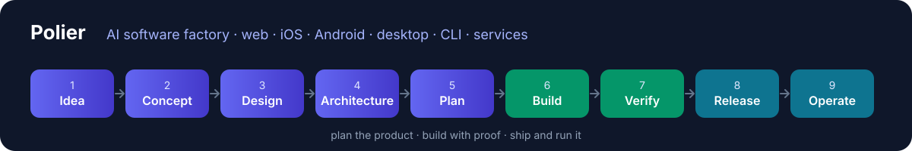

<p align="center">
  
</p>

<p align="center">
  <a href="https://github.com/atshv/Polier/releases"></a>
  <a href="https://github.com/atshv/Polier/actions/workflows/test.yml"></a>
  
  
  
</p>

<p align="center"><b>English</b> · <a href="README.de.md">Deutsch</a></p>

**Polier is an AI software factory for DeepSeek Harness.** You describe the product; Polier runs it through nine stations — idea, concept, design, architecture, plan, build, verify, release, operate — for a website, an iOS or Android app, a desktop app, a CLI or a backend service. At every station it knows what your kind of product needs (sign-up, payments, offline mode, privacy policy, App Store privacy label, Play closed test, signing, monitoring …), asks for proof and closes the station only when you approve it.

## Install

```bash
dsh plugin --profile web add github:atshv/polier
```

Restart DSH (or enable *dsh-polier* under **Plugins**). Python 3.9+ must be on the PATH; nothing else is installed.

## No commands

Open a session in an empty folder and say what you want: *"Build an app with Polier that …"*. From then on you just talk.

| You say | What happens |
|---|---|
| "Is everything ready?" | The agent calls `pl_preflight`: Python, git, DSH services, the write guard and the project, each problem with its fix |
| "What is still missing?" | The agent already sees the live `<polier>` block: station, open items, running task, next move |
| "Close the station." | You get a DSH approval prompt; only your answer closes it |
| "Take task M03." | The session binds the task, claims it and may write only inside its scope |
| "We need the httpx library." | An approval prompt; the answer is recorded in `reviews/approvals/` |
| "Plan the next stage." | The session asks for lead mode — again a prompt you answer |

A "yes" in the chat changes nothing. Decisions are approval prompts, records are written by tools, and `STATUS.md` and `docs/factory.md` regenerate on their own.

## The line

| # | Station | Output | Examples of what it checks |
|---|---|---|---|
| 1 | Idea | `project-input.md`, `factory.json` | problem, users, success signal, non-goals, platforms |
| 2 | Concept | `docs/concept.md` | MVP features, user stories, done scenarios, costs, legal frame |
| 3 | Design | `docs/ux-flows.md`, `docs/design-rules.md` | flows, screens, tokens, states, accessibility, platform guidelines |
| 4 | Architecture | `ARCHITECTURE.md`, ADRs | stack with sources, layers, data model, API, secrets, environments |
| 5 | Plan | `board.json`, `policy.json`, briefs | every build and verify item linked to a task, gates, cold start |
| 6 | Build | code, `runs/`, `reviews/` | auth, data, security, payments, push, permissions, privacy manifest |
| 7 | Verify | gate evidence | E2E, device/browser matrix, accessibility, OWASP/MASVS, beta |
| 8 | Release | `docs/legal.md`, `docs/store/*` | CI from tags, legal texts, store listings, signing, notarisation |
| 9 | Operate | `docs/runbook.md` | errors, uptime, backups, support, updates, store upkeep |

The full checklist — 176 items, each with the platforms and traits it applies to — is [`factory/CATALOG.md`](factory/CATALOG.md). A web app with accounts gets about 100 of them, a CLI about 50.

## Proof, not promises

- An item is done only with evidence: a file in the project (`docs/concept.md#user-stories`) or linked tasks that are done. `must` items are never deferred.
- A task is done only with recorded gate runs, a passing independent review and a handoff.
- A worker writes only inside its task's scope; protected paths, dependency manifests and denied commands follow `policy.json`.
- Every task names a specialist role. A fresh subagent takes it and gets that role's instructions; a role only narrows what it may do.
- DSH goals, subagents and Ralph loops fit in, but their reports are claims: gates and checkpoints decide.

## Inside

| | |
|---|---|
| [`plugin/`](plugin) | the DSH plugin: live context, guide, guard, stop check, the `pl_*` tools |
| [`factory/`](factory) | the catalog of stations and items |
| [`roles/`](roles) | specialist roles — frontend, backend and mobile builders, reviewers, release manager ([`docs/roles.md`](docs/roles.md)) |
| [`core/`](core), [`tools/`](tools) | the rules and the Python tools underneath (also usable headless) |
| [`prompt/`](prompt), [`templates/`](templates) | the process, the rubric and every document template; web front ends take their components from [Magic UI](https://magicui.design) and shadcn/ui ([`templates/ui/magic-ui.md`](templates/ui/magic-ui.md)) |

## Learn more

- **Process** — [`prompt/generator.md`](prompt/generator.md) · **In DSH** — [`prompt/dsh.md`](prompt/dsh.md) · **Your part** — [`guide/cheatsheet.md`](guide/cheatsheet.md)
- **Limits** — Polier is not a sandbox: [what the guard does not cover](docs/guard-limits.md)
- **Tools** — [`docs/tools.md`](docs/tools.md) · **Architecture** — [`docs/architecture.md`](docs/architecture.md)
- **Contributing** — [`CONTRIBUTING.md`](CONTRIBUTING.md), [`AGENTS.md`](AGENTS.md) · **Security** — [`SECURITY.md`](SECURITY.md) · **Changes** — [`CHANGELOG.md`](CHANGELOG.md)

Tests: `npm install && npm test`. Licence: [MIT](LICENSE).
