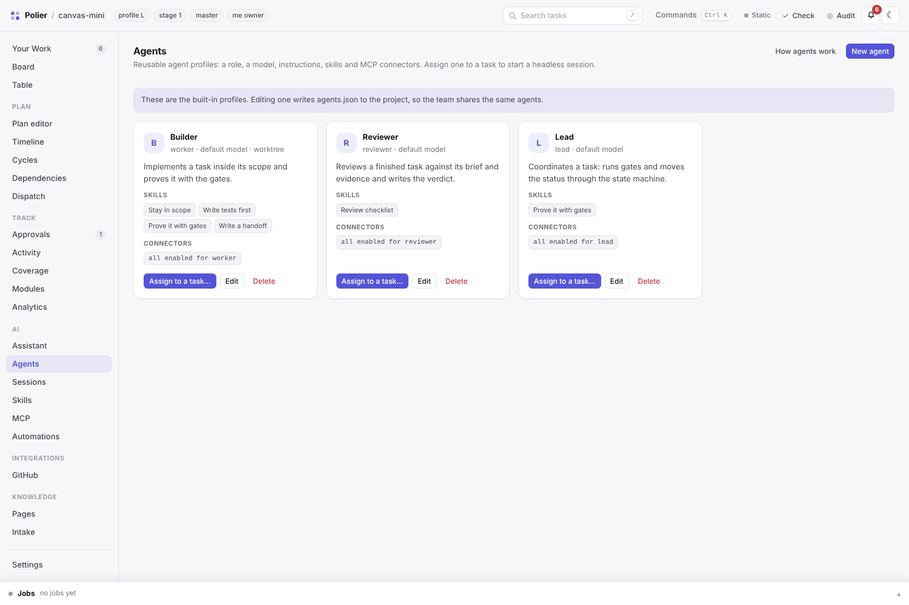

<p align="center">
  
</p>

<p align="center">
  <a href="https://github.com/atshv/Polier/releases"></a>
  <a href="https://github.com/atshv/Polier/actions/workflows/test.yml"></a>
  
  
  
  
</p>

<p align="center">
  <a href="#quick-start"><b>Quick start</b></a> ·
  <a href="#the-dashboard">Dashboard</a> ·
  <a href="#ai-agents-and-mcp">AI &amp; MCP</a> ·
  <a href="#command-line-tools">CLI</a> ·
  <a href="#faq">FAQ</a> ·
  <a href="docs/dashboard.md">Docs</a> ·
  <a href="CHANGELOG.md">Changelog</a>
</p>

**Polier plans an AI coding project before the first line of code — and then keeps the agents to the plan.**

You describe what you want. Polier interviews you, writes a one-page architecture and a task plan with allowed files, acceptance criteria and checks, and sets up the project once you approve. While agents build, it blocks writes outside the current task, accepts only recorded test runs as proof, and commits a record of every attempt, approval and review.

It works with **Claude Code** (hooks, MCP) and **DeepSeek Harness** (plugin), runs on Python's standard library, and keeps everything as plain files in your repository. An optional local **dashboard** puts the board, the plan, the evidence, AI agents and the project docs into one page.

<p align="center"></p>

## Why

| Without Polier | With Polier |
|---|---|
| An agent "quickly fixes" files that belong to another task | The write guard blocks every file outside the task's scope |
| "Tests pass" is a sentence in the chat | Only a recorded gate run with exit code and log hash counts |
| A task is marked done without review | `done` needs a passing review, a handoff and the gate records |
| The next task starts before the one it builds on is finished | `in_progress` is refused while a dependency is open |
| A stuck agent retries forever and burns tokens | Attempts and the token budget are capped; then it escalates |
| `git push` or `npm publish` from an agent session | Denied for every role; releases run in CI from tags |
| Nobody knows later why something was decided | Run records, approvals and reviews are committed with the task |

## Quick start

Requirements: git, Python 3.9+, and Claude Code or DeepSeek Harness.

**1. Install**

```bash
git clone https://github.com/atshv/Polier.git && cd Polier
```

| Your agent | Next step |
|---|---|
| **Claude Code** | `./install.sh claude` installs the skill; add the hooks from [`adapters/claude-code/settings.example.json`](adapters/claude-code/settings.example.json) to `.claude/settings.json` ([details](adapters/claude-code/README.md)) |
| **DeepSeek Harness** | `dsh plugin --profile <name> add .` (from the clone), then restart the harness |
| **Skill only** | `./install.sh` (later `./update.sh`) |

**2. Plan a project.** Open a session in an empty folder and write:

> Plan a new project: a command-line tool that stores my bookmarks locally and finds them again.

Polier asks its questions, shows the plan for approval, writes the project files and gives you the prompt for the first task. Existing repositories work too: the interview has a brownfield mode that reads the code first.

**3. Open the dashboard** (optional):

```bash
python3 tools/serve.py /path/to/project --open
```

Try it on the reference project first: `python3 tools/serve.py examples/monorepo-mini --open`.

## How it works

<p align="center"></p>

1. **Plan** — an interview (phases A–I) produces `ARCHITECTURE.md`, `board.json` with stages and tasks, task briefs and `policy.json`. You approve before anything is built.
2. **Dispatch** — Polier shows the next wave: tasks whose dependencies and stage are open.
3. **Build** — an agent claims one task and may write only inside its `scope.write`.
4. **Prove** — every gate (tests, lint, e2e, …) runs through `tools/gate.py` and leaves a checksummed record.
5. **Review** — a reviewer writes a verdict; `done` needs it, the gate records and a handoff.
6. **Decide** — you grant approvals and close each stage with an owner decision.

The rules live once, in `core/`. The Claude Code hooks, the DeepSeek Harness plugin, the CLI, the dashboard and the MCP server are thin layers over the same functions, so every path enforces the same checks.

## Guardrails in action

Every screen is real output from [`examples/monorepo-mini`](examples/monorepo-mini/).

**The write guard** stops an agent at the first file outside its task, and a denied command stays denied for every role.


**Checkpoints** refuse a status without proof and name the command that produces it.


**The dispatch plan** shows what may start now, what waits and why, and which approvals are open.


## The dashboard

`tools/serve.py` starts a local control plane: one page, one JSON API, no dependencies. It binds to `127.0.0.1`, and everything it does goes through the same `core` functions as the CLI — the CLI never needs it.


| Area | Views |
|---|---|
| **Work** | **Your Work** (inbox and queues), **Board** (Kanban with stage strip), **Table** — filters, saved views, bulk actions in *Select* mode |
| **Plan** | **Plan editor** (interview wizard, tasks, dependencies, stages), **Timeline**, **Cycles**, **Dependencies** graph, **Dispatch** |
| **Track** | **Approvals**, **Activity**, **Coverage** of requirements, **Modules**, **Analytics** |
| **AI** | **Assistant**, **Agents**, **Sessions**, **Skills**, **MCP**, **Automations** |
| **Integrations** | **GitHub** — connect your account, pull requests and CI mapped to tasks |
| **Knowledge** | **Pages** — the project's Markdown plus built-in guides and API reference — and **Intake** for new ideas |

Click any task for the drawer: brief, status transitions, gates with live logs, run events, review, evidence, a headless agent session and the worklog. **Ctrl/Cmd+K** opens the command palette for every view, task and action.

<table>
  <tr>
    <td width="50%"></td>
    <td width="50%"></td>
  </tr>
  <tr>
    <td></td>
    <td></td>
  </tr>
</table>

**Safe by default:** loopback only, an `X-Polier-Action: 1` header and a same-origin check for every write, an optional bearer token (`--token` / `POLIER_DASHBOARD_TOKEN`) and `--read-only` for a viewer screen. Transcripts, logs and machine settings stay in `<git-common-dir>/polier/dashboard/`, never in the repository.

Full guide and API: open **Pages → Guides / API reference** in the dashboard, or read [`docs/dashboard.md`](docs/dashboard.md).

## AI, agents and MCP



- **Assistant** — ask the project questions; answers come with proposals (status change, new task, gate run, session) that run only after you click *Apply*.
- **Agents** — profiles with a role, model, instructions, skills and MCP connectors, committed in `agents.json`. *Assign to a task* starts a headless session that claims the task and runs under the write guard. Builder, Reviewer and Lead work out of the box.
- **Skills** — reusable instructions in `.claude/skills/<id>/SKILL.md`. Agents get them inlined; interactive Claude Code finds them on its own. Five examples ship in [`templates/skills/`](templates/skills/).
- **MCP server** — `tools/mcp.py` gives Claude Code, Claude Desktop, Cursor or VS Code the board as tools. The MCP view has copy-paste setup and a connection test:

  ```bash
  claude mcp add polier -- python3 /path/to/Polier/tools/mcp.py --root /path/to/project --read-only
  ```

- **MCP connectors** — other MCP servers (GitHub, a browser, docs) your agents may use, per role or per agent; stored on your machine with masked secrets.
- **GitHub** — *Connect GitHub* signs the `gh` CLI in with a device code or a token. Polier itself stores no credential.

AI never gets more rights than its role: workers write only inside their task, status changes go through the state machine, and proposals need your confirmation.

## The status page

No server needed: `python3 tools/render_status.py <project> --html` writes `STATUS.html`, one self-contained, read-only page with stages, every task with attempts, gate records, review verdict and token use, plus Kanban, dependency graph, activity and token history. `--watch` re-renders it whenever the project changes — handy for CI artifacts and archives.


## Agent commands

In DeepSeek Harness the plugin adds `/pl` commands; Claude Code uses the environment variables `POLIER_ROLE` (`worker`, `reviewer`, `lead`) and `POLIER_TASK` instead.

| Command | Effect |
|---|---|
| `/pl lead` | this session may write everything (planning, board, merge) |
| `/pl worker` | back to the current task's files (default) |
| `/pl reviewer` | this session writes only under `reviews/` |
| `/pl task M03` | bind this session to one task and claim it; `/pl task` releases it |
| `/pl status` · `/pl next` · `/pl policy` | role and allowed files · dispatch plan · active policy |
| `/pl render` | regenerate `STATUS.md` (lead only) |
| `/pl off` | switch the guard off for this session |

The plugin also gives agents the tools `pl_status`, `pl_gate`, `pl_scope_check`, `pl_check`, `pl_next` and `pl_state`.

## Command-line tools

Every dashboard action has a CLI equivalent. All tools take `--root <project>`, need only Python, and exit with `0` (ok), `1` (refused) or `2` (usage error).

| Daily work | |
|---|---|
| `tools/state.py show\|check\|set` | a task's status — the only writer of the status |
| `tools/gate.py` | run one gate and write a checksummed record |
| `tools/claim.py` · `slot.py` · `worktree.py` | one live session per task, ports and databases per worktree, task checkouts |
| `tools/dispatch.py` | next wave, blocked tasks, conflicts, pending approvals |
| `tools/approve.py` | request, grant, deny and list approvals |
| `tools/session.py` | run, list and stop headless agent sessions |

| Planning and organising | |
|---|---|
| `tools/plan.py` | create, update and delete tasks; labels, estimates, dates, stage decisions |
| `tools/settings.py` · `views.py` | `dashboard.json` (features, labels, your handle) and saved views |
| `tools/intake.py` · `templates.py` | intake proposals and task templates |
| `tools/pages.py` | list, search and read the project's Markdown |
| `tools/assistant.py` · `automations.py` · `github.py` | ask the assistant, dry-run automations, GitHub status and `auth` |

| Checks, reports and integration | |
|---|---|
| `tools/check.py` | lint the whole project: files, board, briefs, policy, evidence, drift |
| `tools/audit.py` | every task against policy, runs, gates and reviews |
| `tools/render_status.py` · `usage.py` | `STATUS.md` / `STATUS.html`, tokens against the budget |
| `tools/scope_check.py` · `boundaries.py` · `contracts.py` | changed files vs. scope, import boundaries, contract schemas |
| `tools/research.py` | dependency versions checked against npm and PyPI, research notes |
| `tools/serve.py` · `mcp.py` | the dashboard, the MCP server |
| `tools/release_check.py` · `smoke.py` · `drift.py` · `manifest.py` | release checks, smoke test, copy drift, package manifest |

## Project files

```
my-project/
├── ARCHITECTURE.md        rules every module follows, one page
├── AGENTS.md              commands and rules for agents
├── board.json             stages, tasks, dependencies, allowed files, status
├── policy.json            limits, approvals, protected paths, denied commands
├── STATUS.md              progress, generated
├── tasks/                 briefs for the next 3–5 tasks
├── runs/                  one execution record per task: attempts, events, usage
├── reviews/               verdicts, gate evidence, approvals
├── docs/                  module map, orchestration, quality, versions, research
│
├── dashboard.json         dashboard features, labels, defaults        (optional)
├── views/  intake/        saved views, intake proposals                (optional)
├── templates/tasks/       task templates                               (optional)
├── automations.json       automation rules                             (optional)
├── agents.json            agent profiles                               (optional)
└── .claude/skills/        skills for agents                            (optional)
```

Everything is committed and reviewable. Machine-local state — transcripts, job logs, MCP connector secrets, read marks — lives in the git common directory and never enters the repository.

## What Polier is not

- **Not an agent.** It does not write code. It plans the work and keeps the agent you already use within it.
- **Not a service.** Files in your repository and Python scripts; no database, no account. The dashboard is a local server you start yourself.
- **Not a sandbox.** The guard stops honest mistakes, not an attacker — see the gaps below.
- **Not telemetry.** Polier sends nothing anywhere. Network calls happen only when you ask: registry lookups in `research.py`, GitHub through `gh`, and MCP connectors you configure.

<details>
<summary><b>What the guard does not cover</b></summary>

The guard keeps honest agents on track; it is not a sandbox. Known gaps:

- **Approvals are cooperative evidence, not authentication.** `reviews/approvals/AP-NNN.json` has no signature and no identity check. Whoever can write the file can forge a granted record, and a shell write is outside the guard. Commit the approval and review it like code.
- **Run records can be forged.** `runs/<ID>.json` is a text file that a hand edit or a shell write can change as easily as the tools; `tools/audit.py` compares it with the board and the evidence folder, not with what happened. A `done` task whose run record was edited is only visible as a contradiction.
- **Command matching is static.** The policy's denied and lead-only patterns are matched against shell segments after quotes, heredocs, assignments and wrappers are stripped, so `git push` is caught. A command assembled by a variable, `eval`, an interpreter or a script file is not.
- **The policy is a file.** Whoever can write `policy.json` can widen the rules. Protect it like the board and review changes to it; the guard reads it, it does not own it.
- **Shell writes it cannot see.** DeepSeek Harness checks only its file tools before a write. Claude Code also checks `Bash`, but only what a static look at the command shows (redirections, `tee`, `cp`/`mv`, `rm`, `touch`, `sed -i`, `perl -i`, `dd of=`, `bash -c`). Not seen: interpreters and scripts (`python -c`, `node -e`, `./build.sh`), build tools and package managers, git commands (`checkout`, `restore`, `stash`, `apply`, `commit`), `xargs`, `find -exec`/`-delete`, `patch`, and paths with variables, globs or `$(...)`. These writes reach only the stop check.
- **The stop check sees only `git status`.** Committed changes, ignored files (`.gitignore`, `.git/info/exclude`) and files outside the repository are invisible. It gives up after `maxStopReminders` (DSH) / `POLIER_MAX_STOP_REMINDERS` (Claude Code) reminders, and it does not run with several tasks in progress, for lead or reviewer sessions, without git, or when it fails.
- **The board is read on every call.** A shell write the guard cannot see can change `board.json` (task status, `scope_write`) and so widen or switch off the guard. The stop check reports the board change, but only while one task is still `in_progress`; `tools/audit.py` shows a status that the run record does not support.
- **Paths are compared as text.** Symlinks are not followed, so a link inside the scope can point outside it. The comparison ignores case on macOS and Windows, where the file system does, but two different spellings on a case-sensitive file system are two different paths. Protected-path patterns use the same comparison.
- **The project is found from the session folder.** A session that starts outside the project, or in a worktree whose `board.json` still shows the task as `pending`, is not guarded until it is bound to a task (`/pl task` in DSH, `POLIER_TASK` in Claude Code).
- **Claims are cooperative.** A live claim stops a second session that uses the claim tools and names the holder; a session that never claims is not stopped by a claim alone. A claim is not a lock on files.
- **Gate records can be forged.** `reviews/evidence/` is always writable, and an agent can write a log and a matching record itself; the gate command is free text. A reviewer must compare the recorded command with `AGENTS.md`.
- **It fails open.** If Python is missing or a hook fails, the write goes through. Roles live in memory (DSH) or in environment variables (Claude Code); whoever can edit the settings can lift them.
- **The kill warning is advisory.** `kill`, `pkill` and `killall` never block a command: DSH sends a message, Claude Code asks. A sandbox is the only real protection against stopping another session's processes.
- **Claude Code specifics.** Only `Write`, `Edit`, `MultiEdit`, `NotebookEdit` and `Bash` are checked, not MCP or other tools that write files. Bash writes outside the project to `/tmp`, the temp folder or `/dev` are not checked, and deleting a file git does not track is allowed (it undoes a write).
- **MCP connectors extend what an agent can reach.** A connector's tools run with the connector's own permissions, outside the write guard. Give agents only the connectors their task needs.

For hard limits, run workers in a sandbox or a container with write access to the task's files only.

</details>

## FAQ

**Do I need to know how to program?** No. You describe the project, answer the interview and approve the plan. The agent writes the code; Polier keeps it on the plan.

**Which agents does it work with?** Claude Code (hooks, headless sessions, MCP) and DeepSeek Harness (plugin with `/pl` commands and `pl_*` tools). The CLI works in any shell, so other agents can use it without the automatic guard. Any MCP client — Claude Desktop, Cursor, VS Code — can read the board through `tools/mcp.py`.

**Do I need the dashboard?** No. The CLI and the hooks are the core; the dashboard is a convenience you start when you want it.

**Can I add Polier to an existing project?** Yes. The brownfield interview reads the repository first (phase B) and plans the next stage from what is there.

**What does a token budget do?** `budget.max_tokens_per_task` in `policy.json` caps what one task may spend across attempts. At 80 % the tools warn; at 100 % the task cannot restart without the owner's approval.

**Does Polier store my GitHub token?** No. Connecting GitHub signs in the `gh` CLI, which keeps the token in its own store.

**What happens when I update Polier?** Running projects keep their `generator_version`. The [changelog](CHANGELOG.md) lists what a project must change per version; update between stages, never during a task.

**Is it free?** Yes, MIT license.

## Repository layout

| Folder | What it holds |
|---|---|
| `core/` | all rules and read models: board, guard, stop check, gates, claims, policy, runs, approvals, state, dispatch, audit, plus planning, knowledge, agents, skills and MCP connectors; tests in `core/tests/` |
| `server/` | the dashboard: HTTP + SSE app, headless sessions, the web UI in `server/assets/` and the built-in handbook in `server/handbook/` |
| `adapters/` | the [DeepSeek Harness plugin](adapters/README.md) and the [Claude Code hooks](adapters/claude-code/README.md) |
| `tools/` | the command-line tools, the dashboard launcher and the MCP server |
| `templates/` | board schema, policy, AGENTS, briefs, gates, dashboard settings, automations, example skills |
| `prompt/` | the planning process ([`generator.md`](prompt/generator.md)), orchestration model and rubric |
| `guide/` | the [step-by-step cheatsheet](guide/cheatsheet.md) |
| `examples/` | [`minimal-cli`](examples/minimal-cli/) (profile S) and [`monorepo-mini`](examples/monorepo-mini/) (profile L); CI checks both |

**Tests:** `npm install && npm test` runs the plugin tests and every Python suite. The core alone: `python3 -m unittest discover -s core/tests -t .`.

## Version history

| Version | Highlights |
|---|---|
| **2.6** | docs-style knowledge with built-in guides and API reference, agents, skills, MCP server setup and connectors, GitHub login |
| **2.5** | calmer dashboard: sidebar, one-row toolbar, select mode, every Kanban column on screen |
| **2.4** | assistant with confirmed proposals, automations (dry run), bulk actions, command palette, GitHub/CI panel |
| **2.3** | pages (Markdown knowledge with search, backlinks, history), intake with triage, task templates |
| **2.2** | timeline, cycles, modules, requirement coverage, analytics |
| **2.1** | project cockpit: settings, labels and estimates, filters and saved views, Your Work and inbox, worklog |
| **2.0** | the local dashboard, headless agent sessions, interview wizard, MCP server |
| **1.0 – 1.4** | board schema 1.0, claims, worktrees, profile L; orchestration with policy, checkpoints, runs, approvals; research; token budgets; the status page |

Details and migration steps: [`CHANGELOG.md`](CHANGELOG.md) and [Releases](https://github.com/atshv/Polier/releases).

## Releasing

Releases are automatic:

1. Set the new number in `VERSION` (for example `2.7.0`).
2. Add a section `## 2.7.0` at the top of `CHANGELOG.md` with what changed and how to migrate.
3. Merge to `main`.

The [release workflow](.github/workflows/release.yml) syncs `package.json` and `tools/manifest.json`, runs the tests, tags `v2.7.0` and publishes a GitHub Release with the changelog section. It stops with a clear message when the section is missing and never overwrites an existing release.

## License

[MIT](LICENSE)
