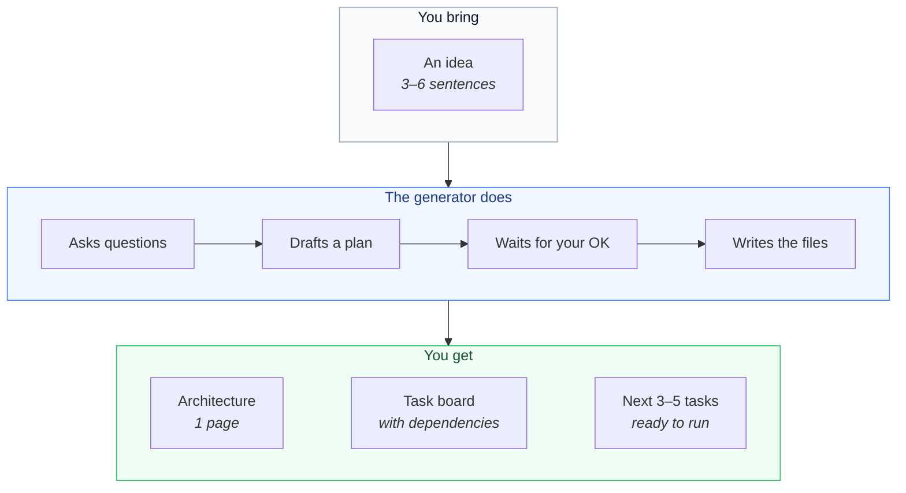
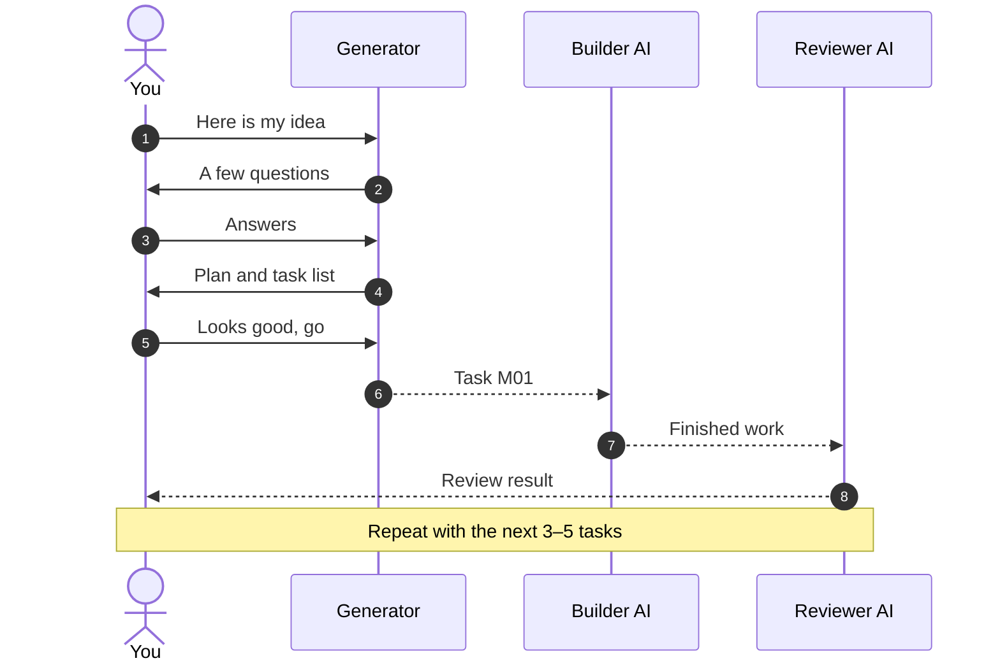
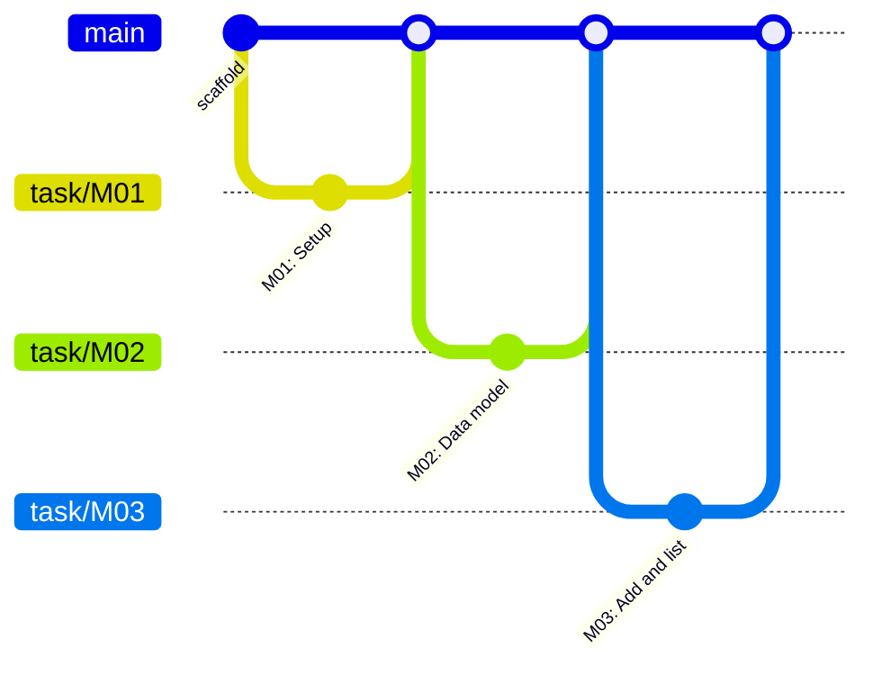
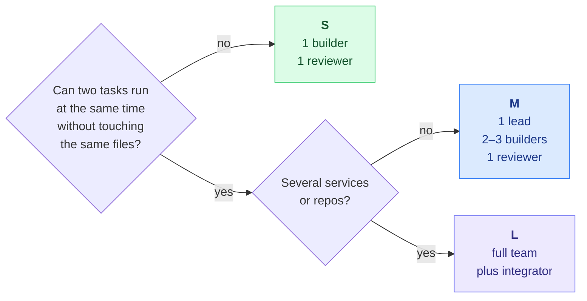

<div align="center">

<br>

# Prompt Generator

**Turn a project idea into a clear plan your AI coding agent can actually follow.**

<br>


<br>

</div>

> **The short version.** You don't get code from this. You get a plan, a task list and clear instructions, so the AI that writes your code stays on track.

<br>

## The big picture



<br>

## A typical session



<br>

## Get started in 5 minutes

- [ ] **Download** this repo. Green **Code** button, then **Download ZIP**.
- [ ] **Open a new chat** with your AI coding tool.
- [ ] **Add these files** to the chat.
  ```
  generator.md   rubric.md   templates/   tools/
  ```
- [ ] **Fill in** the input block at the top of `generator.md`.
- [ ] **Answer** the questions and approve the plan.
- [ ] **Build** with the first task, `tasks/M01.md`.

> [!NOTE]
> The prompts are currently written in **German**. Your project can still be in any language. An English version is planned.

<br>

## What lands in your project

```
my-project/
│
├─ ARCHITECTURE.md ····· the key decisions, one page
├─ AGENTS.md ··········· rules the AI must follow
├─ board.json ·········· every task and what it depends on
├─ STATUS.md ··········· progress, generated from the board
│
├─ tasks/
│   └─ M01.md … M05.md · only the next few tasks
│
└─ docs/ ··············· extra details, only when needed
```

Every task gets its own Git branch and exactly one commit, so your history stays easy to read.



<br>

## How big is your project?

The generator suggests a size for you. Most projects are **S**.



<br>

## Six rules it never breaks

| | | |
|:---|:---|:---|
| **1 · Short plan**<br>One page, not a book. | **2 · One file, one job**<br>Rules, plan and progress stay apart. | **3 · Only what's next**<br>3–5 tasks at a time, not 25. |
| **4 · Few agents**<br>One builder and one reviewer is usually enough. | **5 · Tests first**<br>Code must pass checks before anyone reviews it. | **6 · One writer per file**<br>Two agents never edit the same file at once. |

<br>

## Inside this repo

| | |
|---|---|
| [`generator.md`](generator.md) | **The main prompt.** Start here. |
| [`cheatsheet.md`](cheatsheet.md) | Quick guide for you, with checklists |
| [`rubric.md`](rubric.md) | Quality checks before you approve anything |
| [`dsh.md`](dsh.md) | Setup for sizes M and L |
| [`templates/`](templates/) | Blank templates the generator fills in |
| [`tools/`](tools/) | Python scripts that check a project |
| [`examples/minimal-cli/`](examples/minimal-cli/) | A finished example with 6 tasks |

<details>
<summary><b>Run the checks on the example</b></summary>
<br>

```bash
python3 tools/check.py examples/minimal-cli
python3 tools/render_status.py examples/minimal-cli --out STATUS.md
```

</details>

<br>

## Built on good ideas

[BMAD-METHOD](https://github.com/bmad-code-org/BMAD-METHOD) ·
[GitHub Spec Kit](https://github.com/github/spec-kit) ·
[Claude Code Agent Teams](https://code.claude.com/docs/en/agent-teams) ·
[Cognition](https://cognition.com/blog/dont-build-multi-agents) ·
[Anthropic](https://www.anthropic.com/engineering/building-effective-agents) ·
[AGENTS.md](https://agents.md/)

<br>

<div align="center">
<sub><a href="LICENSE">MIT License</a> · Free to use, change and share</sub>
</div>
