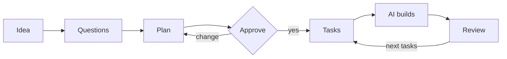

# Prompt Generator

Plan your AI coding project before the AI starts coding.


You describe your idea. The generator asks questions, makes a plan with you and writes clear tasks for an AI coding agent. The agent then builds the project one task at a time.

## How it works



## Quick start

1. Download this repo (**Code** → **Download ZIP**).
2. Add `generator.md`, `rubric.md`, `templates/` and `tools/` to a new AI chat.
3. Fill in the input block at the top of `generator.md`.
4. Answer the questions and approve the plan.
5. Start building with `tasks/M01.md`.

> [!NOTE]
> The prompts are currently in German. Your project can be in any language.

## What you get

```
my-project/
├── ARCHITECTURE.md   key decisions, one page
├── AGENTS.md         rules for the AI
├── board.json        tasks and dependencies
├── STATUS.md         progress
├── tasks/            the next 3–5 tasks
└── docs/             details, only if needed
```

See a full example in [`examples/minimal-cli/`](examples/minimal-cli/).

## Principles

- **Short plan.** One page, not a book.
- **Small steps.** Only the next 3–5 tasks are planned.
- **Checks first.** Tests run before any review.
- **Independent review.** The AI never grades its own work.

## Files

| File | Purpose |
|---|---|
| [`generator.md`](generator.md) | The main prompt |
| [`cheatsheet.md`](cheatsheet.md) | Quick guide |
| [`rubric.md`](rubric.md) | Quality checks |
| [`dsh.md`](dsh.md) | Setup for multiple agents |
| [`templates/`](templates/) | Templates |
| [`tools/`](tools/) | Check scripts |

## License

[MIT](LICENSE). Free to use, change and share.
