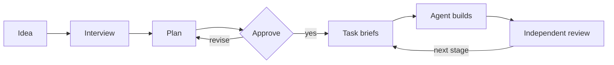

# Prompt Generator

Plans an AI coding project before any code is written.


The generator interviews you, drafts a one-page architecture and a task DAG, and after your approval writes a scaffold that an AI coding agent builds from, one task at a time. Built for the DeepSeek Harness ([`dsh.md`](dsh.md)); usable in any agent or chat.



## Installation

**As a skill** — copy this folder into a skills directory and ask the agent to plan your project:

| Agent | Folder |
|---|---|
| DeepSeek Harness | `~/.dsh/skills/prompt-generator/` |
| Claude Code | `~/.claude/skills/prompt-generator/` |

**In any chat** — attach `generator.md`, `rubric.md`, `templates/` and `tools/`, then fill in the input block at the top of `generator.md`. For an existing project, place the package in `.generator/`; it is kept out of git.

## Output

```
my-project/
├── ARCHITECTURE.md   invariants, one page
├── AGENTS.md         commands and rules for agents
├── board.json        tasks, dependencies, write scopes
├── STATUS.md         progress, generated from board.json
├── tasks/            next 3–5 task briefs
├── reviews/          review results per task
└── docs/             module map, quality gates; ADRs and contracts when needed
```

A git repository on `main`, initial commit `chore: scaffold`, one commit per task.

## Principles

- **One-page architecture.** Only invariants that keep modules from diverging; max. 800 words.
- **Just in time.** Only the next 3–5 tasks are briefed.
- **Gates before opinions.** Deterministic checks run before any review.
- **Independent review.** No agent grades its own work.
- **Right-sized team.** One writer by default; more only for truly parallel work.
- **Traceable.** Definition of done → task → acceptance criterion → gate, verified by `tools/check.py`.

## Contents

| Path | Purpose |
|---|---|
| [`SKILL.md`](SKILL.md) | Skill entry point |
| [`generator.md`](generator.md) | The process: phases 0–I, rules, handoff prompts |
| [`rubric.md`](rubric.md) | Quality criteria, lint list, critic and cold-start prompts |
| [`cheatsheet.md`](cheatsheet.md) | Checklists and red flags for the human |
| [`dsh.md`](dsh.md) | DeepSeek Harness tool mapping and fallbacks |
| [`templates/`](templates/) | Artifact templates and board schema |
| [`tools/`](tools/) | `check.py` (validation), `render_status.py` (STATUS from board); Python 3.9+, no dependencies |
| [`examples/minimal-cli/`](examples/minimal-cli/) | Reference project |

## Example

[`examples/minimal-cli/`](examples/minimal-cli/) is a bookmark CLI with six tasks, captured while M03 is in progress: [`project-input.md`](examples/minimal-cli/project-input.md) is the generator input, [`tasks/M03.md`](examples/minimal-cli/tasks/M03.md) the current brief, [`reviews/M03.md`](examples/minimal-cli/reviews/M03.md) its first review round. Stage 2 (M04–M06) has no briefs yet.

```bash
python3 tools/check.py examples/minimal-cli
```

## Acknowledgements

BMAD-METHOD, GitHub Spec Kit, Claude Code agent teams, Cognition, Anthropic's evaluator-optimizer pattern, AGENTS.md.

## License

[MIT](LICENSE)
