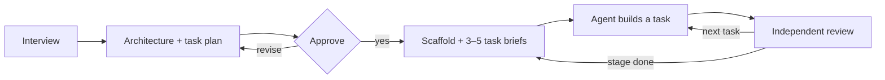

# Prompt Generator

Plan an AI coding project before the first line of code.


The Prompt Generator is an agent skill for the DeepSeek Harness. It interviews you, drafts a one-page architecture and a task plan, and after your approval writes a project scaffold that coding agents build from, one reviewed task at a time.

## Quick start

Requirements: DeepSeek Harness, git, Python 3.9+.

```bash
git clone <repository-url> prompt-generator && cd prompt-generator
./install.sh --ref "v$(cat VERSION)"
```

Open a new DSH session in an empty project folder and write:

> Plan a new project: a command-line tool that stores my bookmarks locally and finds them again.

The generator asks its questions, shows the plan for approval, writes the scaffold and hands over the prompt for the first task.

## How it works



| Step | Result |
|---|---|
| Interview | goals, definition of done, constraints, team size |
| Plan | one-page architecture, task DAG with scopes and gates |
| Scaffold | git repository, rules for agents, briefs for the next 3–5 tasks |
| Build | one task per session, verified by deterministic gates |
| Review | a separate agent checks every acceptance criterion against the diff |

## What you get

```
my-project/
├── ARCHITECTURE.md   invariants, one page
├── AGENTS.md         commands and rules every agent follows
├── board.json        tasks, dependencies, write scopes, status
├── STATUS.md         progress and next tasks, generated from board.json
├── tasks/            briefs for the next 3–5 tasks
├── reviews/          review results per task
└── docs/             module map, quality gates, decisions
```

## Principles

- **One-page architecture** — only the invariants that keep modules consistent.
- **Just in time** — only the next 3–5 tasks are specified in detail.
- **Gates before opinions** — deterministic checks run before any review.
- **Independent review** — no agent approves its own work.
- **Right-sized team** — one writer by default; parallel agents only for parallel work.
- **Traceable** — definition of done → task → acceptance criterion → gate, enforced by `tools/check.py`.

## Installation and updates

| Task | Command |
|---|---|
| Install for all projects | `./install.sh --ref "v$(cat VERSION)"` |
| Install for one project | `./install.sh <project>/.dsh/skills` |
| Update to the latest version | `git pull && ./update.sh --ref "v$(cat VERSION)"` |
| Roll back | `./update.sh --ref v0.5.6` |
| Claude Code | add the target `claude` to any command above |

Without `--ref`, the scripts install the current checkout, including uncommitted changes. Before updating a running project, read [`CHANGELOG.md`](CHANGELOG.md); update between stages, never during a task.

Without skill support, attach `prompt/generator.md`, `prompt/rubric.md`, `templates/` and `tools/` to the chat and fill in the input block at the top of `prompt/generator.md`.

## Repository

```
├── SKILL.md            skill entry point
├── prompt/             generator.md (process), rubric.md (quality), dsh.md (DSH tool mapping)
├── templates/          artifact templates and board schema
├── tools/              check.py (validation), render_status.py (STATUS.md)
├── guide/              cheatsheet.md: checklists for the human
├── examples/           minimal-cli: reference project
├── install.sh          install, update.sh: update or roll back
└── CHANGELOG.md        releases and migration steps; current version in VERSION
```

## Example

[`examples/minimal-cli`](examples/minimal-cli/) is a bookmark CLI with six tasks, captured during the third task: the [generator input](examples/minimal-cli/project-input.md), the [architecture](examples/minimal-cli/ARCHITECTURE.md), the [current brief](examples/minimal-cli/tasks/M03.md) and its [first review](examples/minimal-cli/reviews/M03.md).

```bash
python3 tools/check.py examples/minimal-cli
```

## License

[MIT](LICENSE). Ideas from BMAD-METHOD, GitHub Spec Kit, Claude Code agent teams, Cognition, Anthropic's evaluator-optimizer pattern and AGENTS.md.
