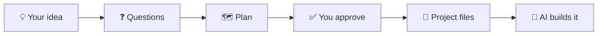

<div align="center">

# 🧭 Prompt Generator

**Plan your AI coding project before the AI starts coding.**

You describe your idea. The generator asks questions, plans the project with you<br>
and writes the files an AI coding agent needs to build it, one step at a time.


</div>

---

## 🤔 Why?

When you ask an AI to "build me an app", it often gets lost. It forgets decisions, rewrites working code and calls its own work perfect.

This generator fixes that by giving the AI **a clear plan and small, focused tasks**, just like a good project lead would.

## ⚙️ How it works



1. **You describe your idea** in a few sentences.
2. **The generator asks you questions** (max. 10 at a time).
3. **It shows you a plan.** Nothing is written until you say yes.
4. **It creates the project files.** A short architecture, a task list and the next 3–5 tasks.
5. **An AI agent builds the project**, one task at a time.
6. **A second AI reviews the work**, so nobody grades their own homework.

## 🚀 Quick start

1. Download this repository (green **Code** button → **Download ZIP**).
2. Open a new chat with your AI coding tool and add these files.
   - `generator.md`
   - the `templates/` folder
   - `rubric.md`
   - the `tools/` folder
3. Fill in the input block at the top of `generator.md` (your idea, project size, language).
4. Answer the questions and approve the plan.
5. Start building with the first task, `tasks/M01.md`.

> [!NOTE]
> The prompts are currently written in **German**. Your project can still be in any language. An English version is planned.

## 📦 What you get

| File | What it is |
|---|---|
| `ARCHITECTURE.md` | One page with the key decisions for your project |
| `AGENTS.md` | Rules the AI must follow |
| `board.json` + `STATUS.md` | Task list and progress |
| `tasks/` | The next 3–5 tasks, each with clear instructions |
| `docs/` | Extra details, only when needed |

See a complete example in [`examples/minimal-cli/`](examples/minimal-cli/).

## 🧠 The six rules behind it

1. **Keep the plan short.** One page, not a book.
2. **One file, one job.** Rules, plan and progress live in separate files.
3. **Only plan what's next.** 3–5 tasks at a time, not 25.
4. **Few agents.** One builder and one reviewer is usually enough.
5. **Tests before opinions.** Code must pass checks before anyone reviews it.
6. **One writer per file.** Two agents never edit the same file at once.

## 📂 What's in this repo

| File | Purpose |
|---|---|
| [`generator.md`](generator.md) | The main prompt. Start here. |
| [`cheatsheet.md`](cheatsheet.md) | Quick guide for you, with checklists |
| [`rubric.md`](rubric.md) | Quality checks before you approve anything |
| [`dsh.md`](dsh.md) | Setup for multiple agents (bigger projects) |
| [`templates/`](templates/) | Blank templates the generator fills in |
| [`tools/`](tools/) | Small Python scripts that check a project |
| [`examples/`](examples/) | A finished example project |

Check the example yourself.

```bash
python3 tools/check.py examples/minimal-cli
```

## 👥 Who is it for?

- ✅ **Solo developers** building a small or medium project with AI
- ✅ **Small teams** running 2–3 AI agents in parallel
- ✅ **Anyone with a pile of prompts** who wants a clean structure
- ❌ **Not for one-line demos.** A single prompt is enough for those.

## 🙏 Inspired by

[BMAD-METHOD](https://github.com/bmad-code-org/BMAD-METHOD) ·
[GitHub Spec Kit](https://github.com/github/spec-kit) ·
[Claude Code Agent Teams](https://code.claude.com/docs/en/agent-teams) ·
[Cognition](https://cognition.com/blog/dont-build-multi-agents) ·
[Anthropic](https://www.anthropic.com/engineering/building-effective-agents) ·
[AGENTS.md](https://agents.md/)

## 📄 License

[MIT](LICENSE). Free to use, change and share.
