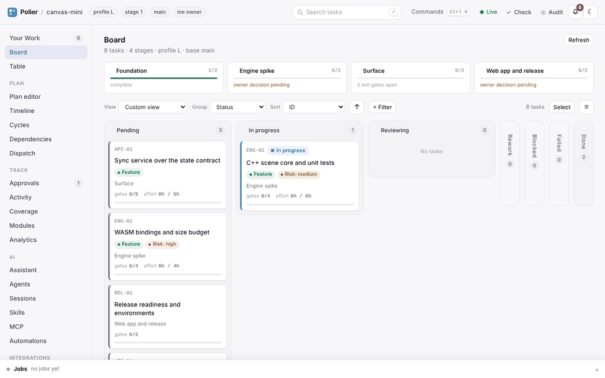
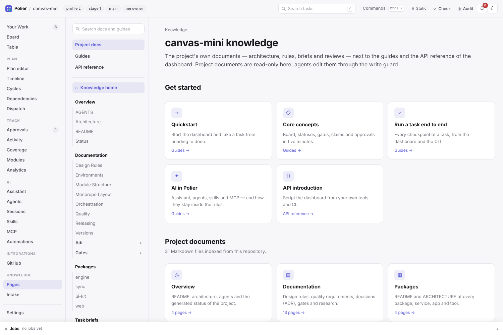

<p align="center">
  
</p>

<p align="center">
  <a href="https://github.com/atshv/Polier/releases"></a>
  <a href="https://github.com/atshv/Polier/actions/workflows/test.yml"></a>
  
  
  
</p>

<p align="center"><b>English</b> · <a href="README.de.md">Deutsch</a></p>

**Polier is the site foreman for AI coding agents.** You describe what you want; Polier interviews you and writes a one-page architecture and a task plan with allowed files, acceptance criteria and checks. Once you approve, agents build task by task — and Polier blocks every write outside the current task, accepts only recorded test runs as proof, and keeps a reviewable record of every attempt, approval and review.

Works with **Claude Code**, any **MCP** client and **DeepSeek Harness**. Python standard library only, everything stays as files in your repository.

<p align="center"></p>

## Why

| Without Polier | With Polier |
|---|---|
| An agent "quickly fixes" files of another task | Writes outside the task's scope are blocked |
| "Tests pass" is a sentence in the chat | Only a recorded gate run with exit code and log hash counts |
| Tasks start before what they build on is done | `in_progress` is refused while a dependency is open |
| A stuck agent retries forever | Attempts and token budgets are capped, then it escalates |
| Nobody knows later why something was decided | Runs, approvals and reviews are committed with the task |

## Quick start

```bash
git clone https://github.com/atshv/Polier.git && cd Polier
./install.sh claude          # Claude Code; for DeepSeek Harness: dsh plugin --profile <name> add .
```

Then open a session in an empty folder and write *"Plan a new project: …"* — Polier asks its questions, shows the plan for approval and writes the project files. The dashboard is optional:

```bash
python3 tools/serve.py /path/to/project --open      # try it: examples/monorepo-mini
```

The dashboard follows your browser language (English or German); switch it under **Settings → Language**, in the command palette (Ctrl/Cmd+K) or with `?lang=en`. Hooks for Claude Code: [`adapters/claude-code/README.md`](adapters/claude-code/README.md).

## Proof, not promises

<p align="center"></p>

1. **Plan** — interview → `ARCHITECTURE.md`, `board.json`, task briefs, `policy.json`. You approve.
2. **Build** — an agent claims one task and may write only inside its scope.
3. **Prove** — every gate runs through Polier and leaves a checksummed record.
4. **Review** — `done` needs a passing verdict, the gate records and a handoff.

## What's inside

| | |
|---|---|
| **Guardrails** | write guard, checkpoints, claims, approvals, token budgets — in `core/`, shared by every entry point |
| **Dashboard** | board, table, timeline, cycles, coverage, analytics, approvals, your inbox, command palette — in **English and German** |
| **AI** | assistant with confirmed proposals, agent profiles, skills, MCP server and connectors, GitHub login |
| **Knowledge** | project docs as a docs site, plus a built-in handbook and API reference |
| **CLI** | 31 tools with the same rules, from `state.py` to `mcp.py` — see [the cheatsheet](guide/cheatsheet.md) |

<table>
  <tr>
    <td width="50%"></td>
    <td width="50%"></td>
  </tr>
  <tr>
    <td></td>
    <td></td>
  </tr>
</table>

## Learn more

- **Dashboard & API** — [`docs/dashboard.md`](docs/dashboard.md), or *Pages → Guides / API reference* inside the dashboard
- **Connect your AI client** — `claude mcp add polier -- python3 tools/mcp.py --root <project> --read-only`
- **Limits** — Polier is not a sandbox: [what the guard does not cover](docs/guard-limits.md)
- **Changes** — [`CHANGELOG.md`](CHANGELOG.md) · [Releases](https://github.com/atshv/Polier/releases)

Tests: `npm install && npm test`. License: [MIT](LICENSE).
