<p align="center">
  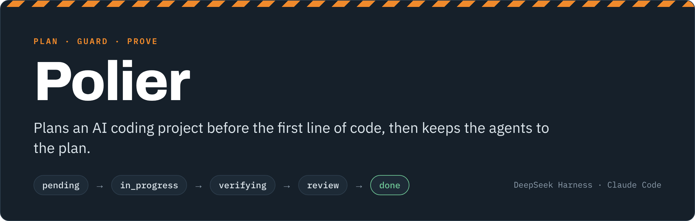
</p>

<p align="center">
  <a href="https://github.com/atshv/Polier/releases"></a>
  <a href="https://github.com/atshv/Polier/actions/workflows/test.yml"></a>
  
  
  
</p>

<p align="center">
  <a href="#install"><b>Install</b></a> ·
  <a href="#start">Start</a> ·
  <a href="#the-dashboard">Dashboard</a> ·
  <a href="examples/monorepo-mini/">Example project</a> ·
  <a href="#faq">FAQ</a> ·
  <a href="CHANGELOG.md">Changelog</a> ·
  <a href="https://github.com/atshv/Polier/releases">Releases</a>
</p>

Polier works with [DeepSeek Harness](https://github.com/deepseek-ai/deepseek-harness) as a plugin and with Claude Code as hooks. It interviews you, writes a one-page architecture and a task plan, and sets up the project after your approval. While agents build, it blocks writes outside the current task, accepts only recorded test runs as proof, and commits a record of every attempt, approval and review round. 2.0 adds an optional local dashboard: board, plan, approvals, gate logs and headless agent sessions in one page — still no dependencies, still files on disk.

<p align="center">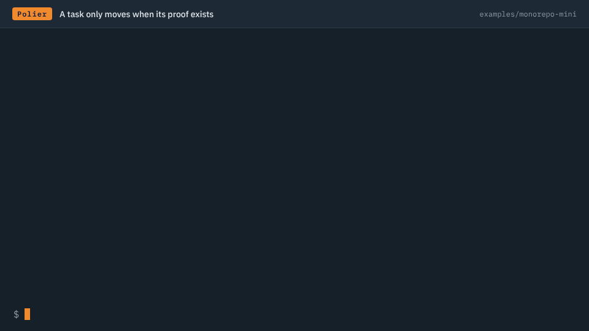</p>

## Why

| Without Polier | With Polier |
|---|---|
| An agent "quickly fixes" files that belong to another task | The write guard blocks every file outside the task's list |
| "Tests pass" is a sentence in the chat | Only a recorded gate run with exit code and log hash counts |
| A task is marked done without review | `done` needs a passing review, a handoff and the gate records |
| The next task starts before the one it builds on is finished | `in_progress` is refused while a dependency is open |
| A stuck agent retries forever and burns tokens | Attempts and the token budget are capped; then it escalates |
| `git push` or `npm publish` from an agent session | Denied for every role, releases run in CI from tags |
| Nobody knows later why something was decided | Run records, approvals and reviews are committed with the task |

## How it works

<p align="center">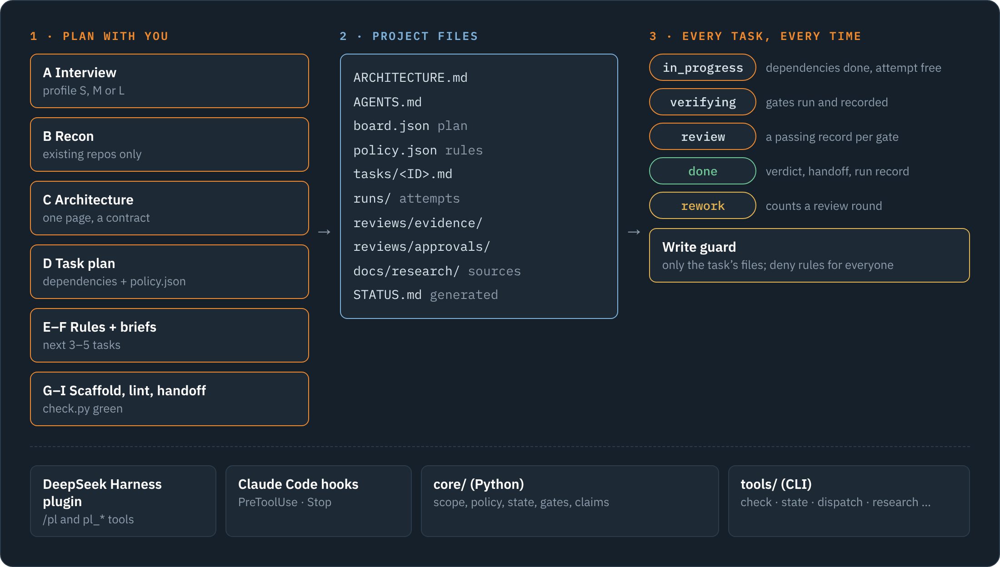</p>

The rules live once, in `core/` (Python, standard library only). The DeepSeek Harness plugin and the Claude Code hooks only translate their host's events into calls to it, and the command-line tools in `tools/` work in any shell.

## What it looks like

Every screen is real output from the reference project [`examples/monorepo-mini`](examples/monorepo-mini/).

**The write guard** stops an agent at the first file outside its task, and a denied command stays denied for every role.

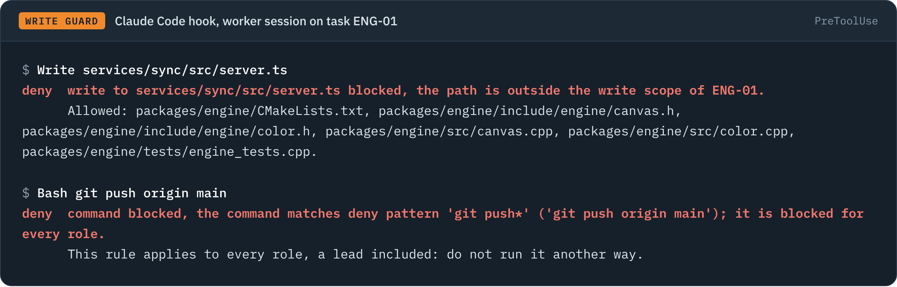

**Checkpoints** refuse a status that has no proof behind it, and say which command produces the proof.

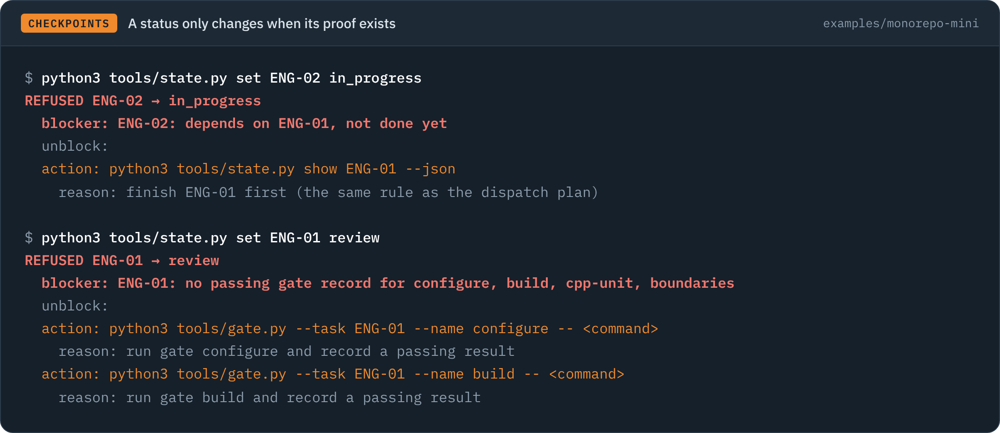

**The dispatch plan** shows what may start now, what waits and why, and which approvals are open.

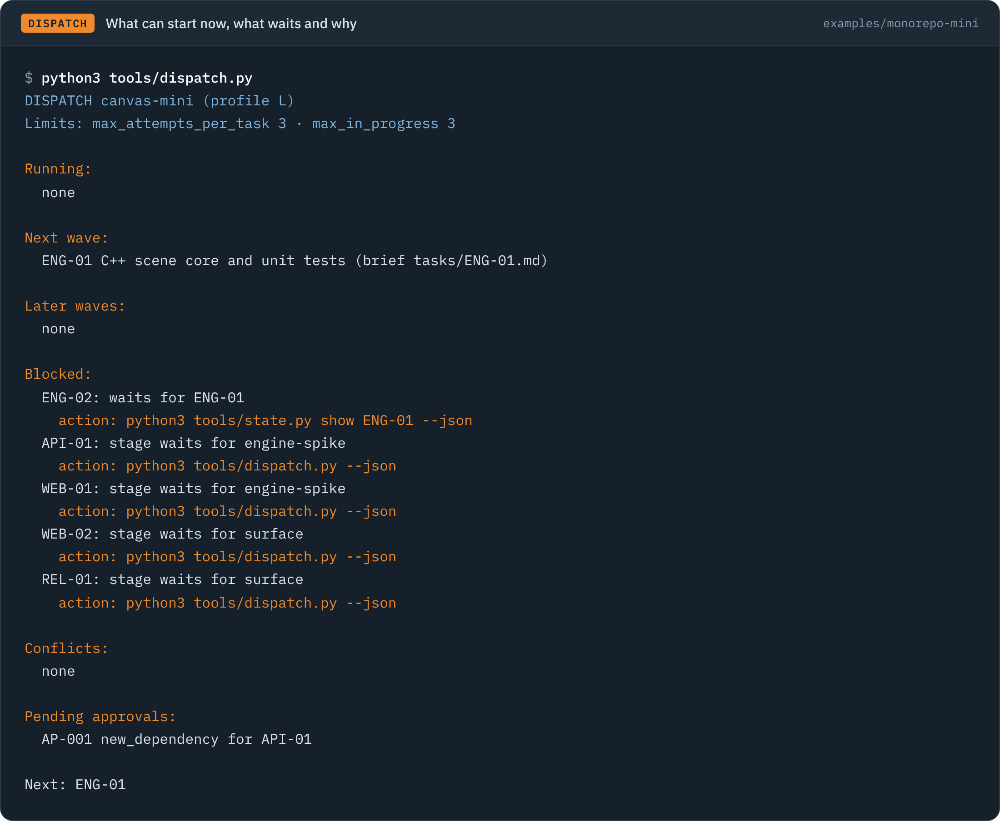

**Research** checks every pinned version against npm and PyPI and keeps findings with dated sources in `docs/research/`.

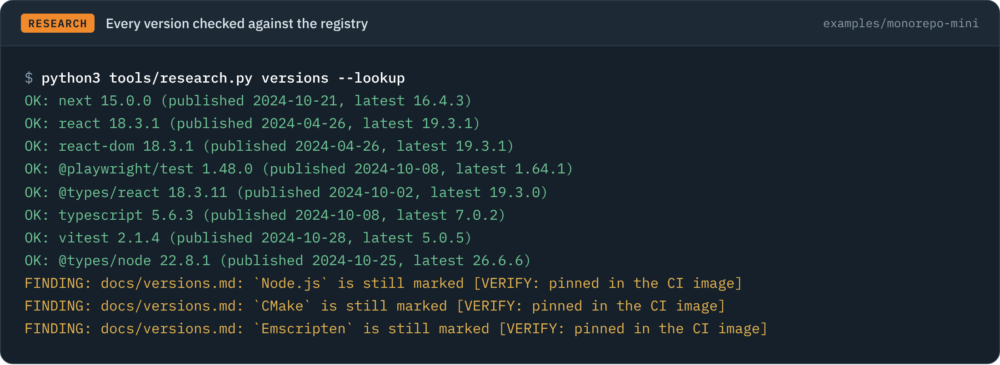

## The status page

The status page shows the whole project at a glance: stages, every task with attempts, gate records, review verdict and tokens against the budget (the counts in the picture are example values). `render_status.py --html` writes it as one self-contained file without a server, and 1.4 adds four read-only views: a Kanban board, a dependency graph drawn as inline SVG with the critical path highlighted and cycles flagged as a warning instead of crashing, an activity timeline built from run events, usage records and approvals, and a token history with a total line, one line per stage and the budget line from `budget.max_tokens_per_task`. Stage, package and owner filters above the table and the CSS table/Kanban switch need no build step, and without JavaScript everything is still visible; the page itself is read-only, and only `tools/state.py` writes a status. `--watch [--interval 2]` polls `board.json`, `runs/`, `reviews/` and `policy.json`, rewrites both pages atomically and adds a 5-second meta refresh only while watching.

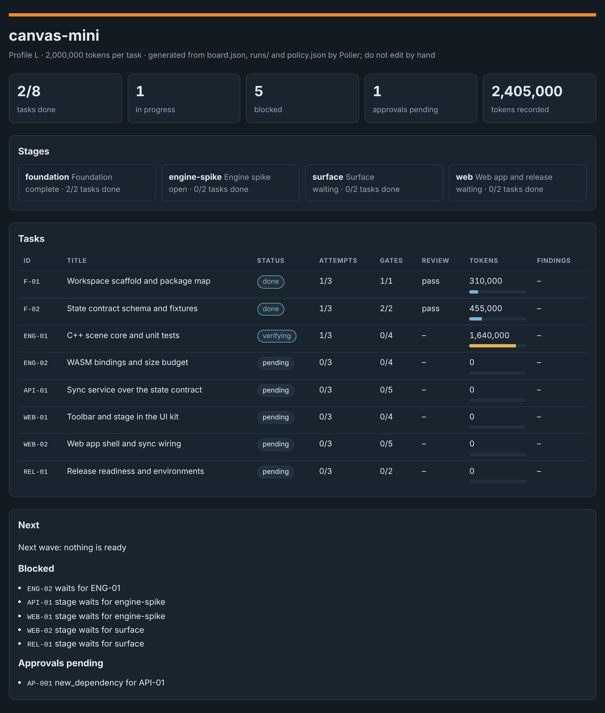

## The dashboard

`tools/serve.py` starts a local control plane for a project — one page, one small JSON API, Python standard library only:

```bash
python3 tools/serve.py /path/to/project --port 8765 --open
```

2.5 makes it calmer to use: a grouped sidebar instead of twenty tabs, a one-row toolbar, bulk actions as an explicit Select mode, every Kanban column on screen and a visible Ctrl/Cmd+K command palette; Pages becomes a documentation site with built-in guides and an API reference; an AI area adds agent profiles, skills, MCP server setup and MCP connectors, and GitHub can be connected from the dashboard. 2.1 adds the project cockpit: the Settings view edits the committed `dashboard.json` (feature flags, label definitions, the owner handle), structured filters can be saved as `views/`, "Your Work" and the inbox collect what needs the owner's attention, and every task shows its worklog (attempts, sessions, gates, tokens) against the optional `estimate_hours`. Labels (schema 1.1) group work across the board, table and filters. 2.4 adds the intelligence layer: **Assistant** (read-only briefing, answers with structured proposals, applied only after confirmation), **Automations** (committed rules, dry-run suggestions from gates, blocked tasks, reviews, intake and stage decisions), **bulk operations**, a **command palette** and a **GitHub/CI** panel via `gh`. 2.3 adds the knowledge layer: **Pages** browses every Markdown document (root docs, `docs/`, briefs, reviews, package docs) with collections, search, favorites, backlinks and git history; **Intake** collects ideas and issues as committed proposals and accepts them into validated pending tasks; **task templates** in `templates/tasks/` carry reusable scope/gates/labels/estimates. 2.2 adds the planning overview: **Timeline** (auto-scheduled from dependencies and estimates, optional `planned_start`/`target` dates in schema 1.2, critical path), **Cycles** (stages with burndown, exit gates and owner decisions), **Modules** (packages with health, docs and contracts), **Coverage** (D-requirements joined with tasks and evidence) and **Analytics** (throughput, cycle time, gate pass rate, rework, effort and tokens).

It shows the plan as a board (Kanban and table), opens every task with its brief, gates, evidence and events, runs gates and checks with live logs, shows approvals and dispatch, and can start a headless agent session for a task (Claude Code by default, with the shipped hooks and scope guard) while streaming its transcript and recording tokens. The interview wizard collects the Phase-A answers, starts a generator session and lets you approve the plan; for existing projects the Plan view edits tasks, dependencies and scopes with the same validation as the CLI. `tools/mcp.py` exposes the board to any MCP host, so an interactive Claude Code session can read the plan and call lead-only actions as tools.

It binds to `127.0.0.1` by default, needs the `X-Polier-Action: 1` header for writes, rejects cross-origin actions, can require a bearer token (`--token`/`POLIER_DASHBOARD_TOKEN`) and runs read-only with `--read-only`. Everything the page does goes through the same `core` functions as the CLI; the CLI never needs the server, and nothing of the dashboard is committed (transcripts and logs live in `<git-common-dir>/polier/dashboard/`). Details: [`docs/dashboard.md`](docs/dashboard.md).

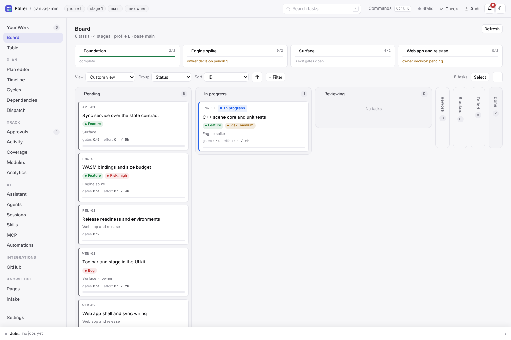
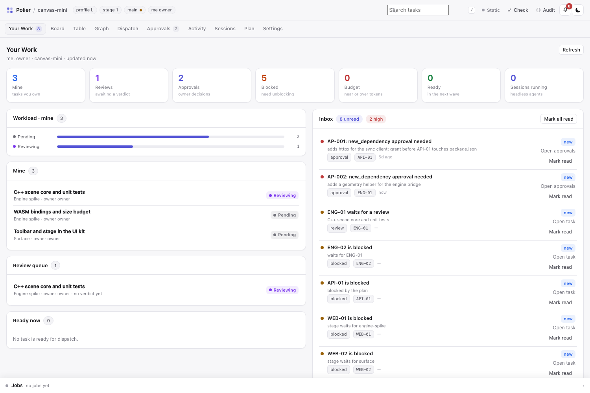
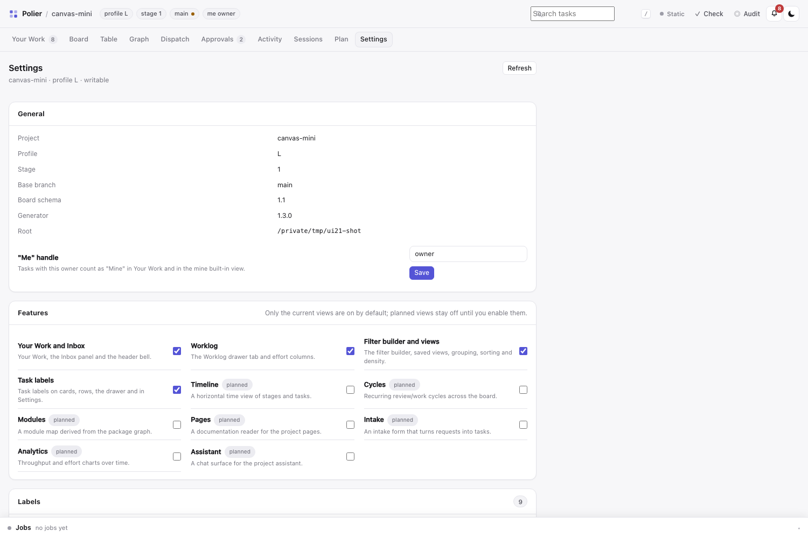
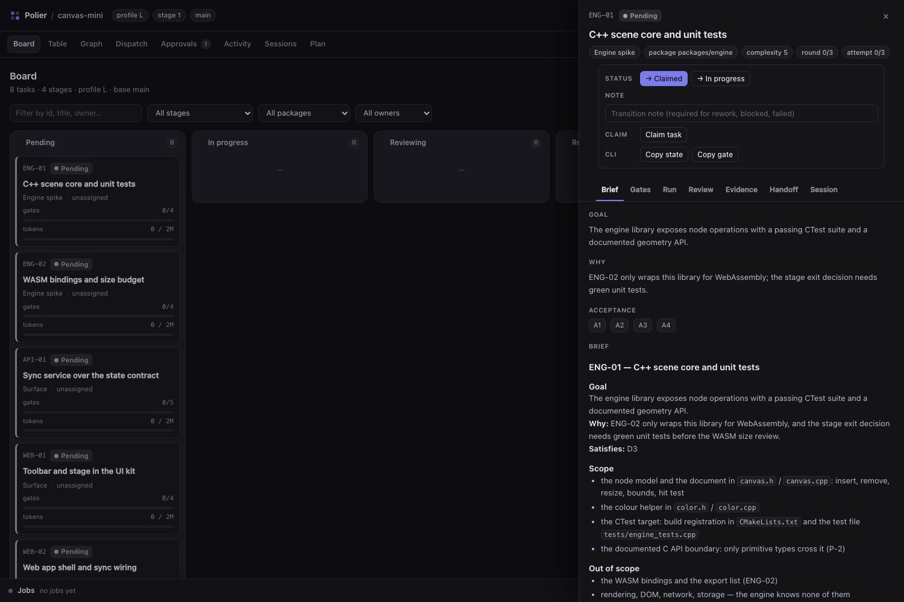
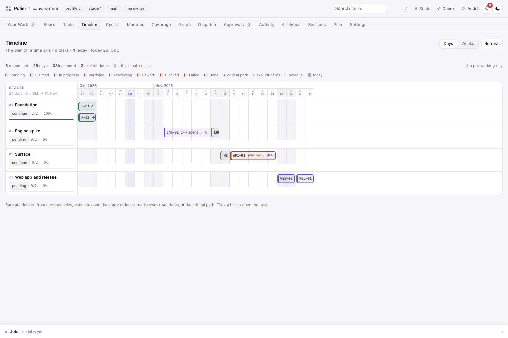
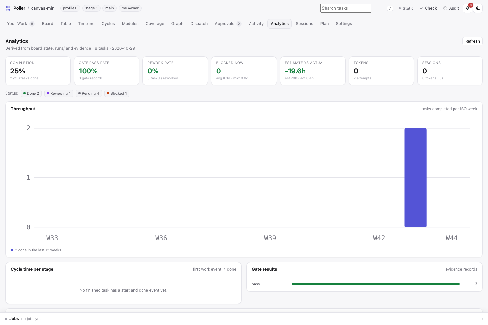
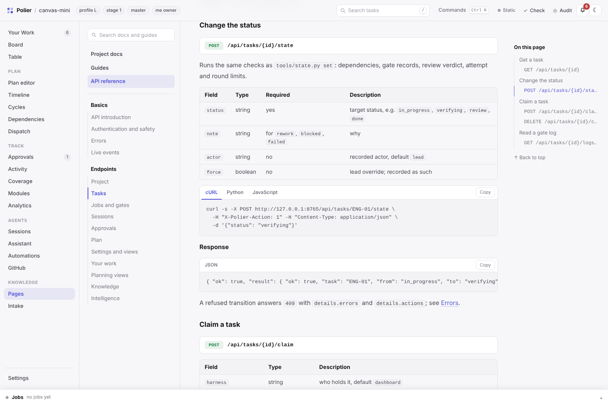
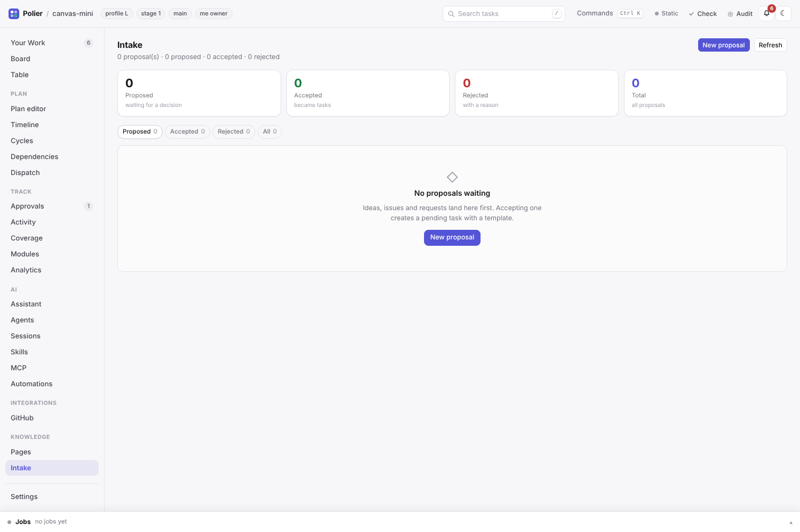
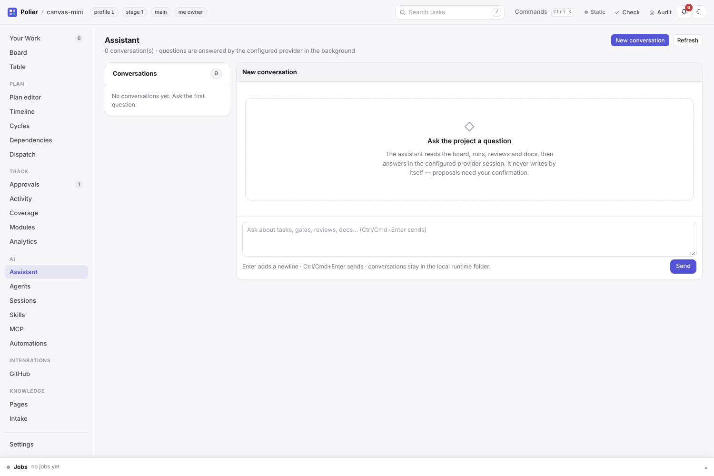
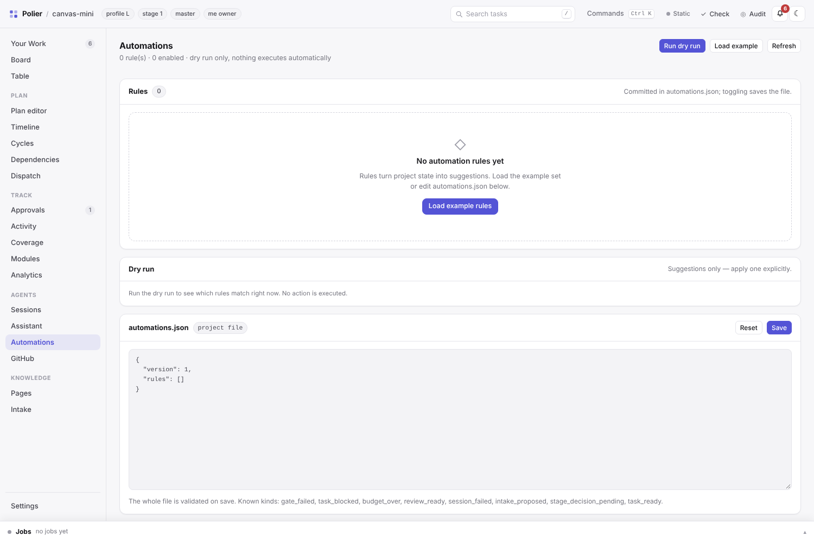
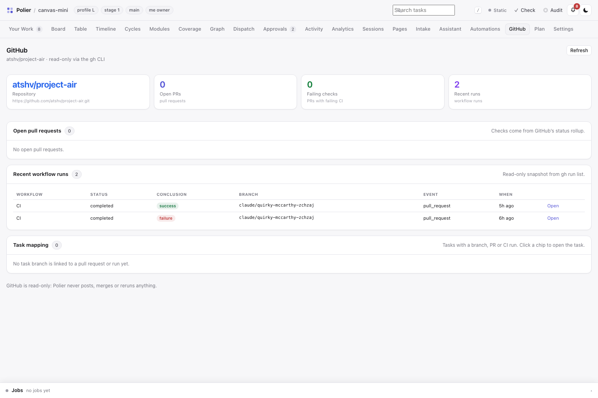

## Install

Requirements: DeepSeek Harness or Claude Code, git, Python 3.9+.

```bash
git clone https://github.com/atshv/polier.git
dsh plugin --profile web add ./polier
```

Use your own profile name instead of `web`, then restart the harness. To update, run `git pull` in the clone, run the same `add` command again and restart.

**Claude Code:** run `./install.sh claude`, then add the hooks from [`adapters/claude-code/settings.example.json`](adapters/claude-code/settings.example.json) to `.claude/settings.json`. Roles and settings: [`adapters/claude-code/README.md`](adapters/claude-code/README.md).

**Skill only, without the plugin:** `./install.sh`, later `./update.sh`.

## Start

Open a new session in an empty folder and write:

> Plan a new project: a command-line tool that stores my bookmarks locally and finds them again.

Polier asks its questions, shows the plan for approval, writes the project files and gives you the prompt for the first task. From then on every task moves through checkpoints instead of a hand-edited board.

## Commands

In DeepSeek Harness. Claude Code uses the environment variables `POLIER_ROLE` and `POLIER_TASK` instead.

| Command | Effect |
|---|---|
| `/pl lead` | this session may write everything (planning, board, merge) |
| `/pl worker` | back to the current task's files (default) |
| `/pl reviewer` | this session writes only under `reviews/` |
| `/pl off` | switch the guard off for this session |
| `/pl task M03` | bind this session to one task and claim it; `/pl task` releases the claim |
| `/pl status` | show role, task and allowed files |
| `/pl next` | show the dispatch plan |
| `/pl policy` | show the active policy |
| `/pl render` | regenerate `STATUS.md` (lead only) |

The plugin also gives agents the tools `pl_status`, `pl_gate`, `pl_scope_check`, `pl_check`, `pl_next` and `pl_state`.

## Command-line tools

| Tool | Purpose |
|---|---|
| `tools/check.py` | lint a generated project: files, board, briefs, budgets, stages, evidence, policy, runs, approvals, drift |
| `tools/state.py` | `show`, `check`, `set` a task's status; the only writer of the status |
| `tools/gate.py` | run one gate, lock shared resources, write a checksummed record |
| `tools/approve.py` | `request`, `grant`, `deny`, `list`, `check` approval records |
| `tools/dispatch.py` | the dispatch plan: waves, blocked tasks, conflicts, pending approvals |
| `tools/audit.py` | compliance view of every task against policy, runs, gates and reviews |
| `tools/research.py` | dependencies, versions checked against npm and PyPI, research notes with sources |
| `tools/usage.py` | token use per task against `budget.max_tokens_per_task` |
| `tools/render_status.py` | regenerate `STATUS.md`; with `--html` also the status page `STATUS.html`, `--watch [--interval N]` re-renders both on change |
| `tools/scope_check.py` | changed files against the task's scope, with foreign-change detection |
| `tools/claim.py` · `slot.py` · `worktree.py` | one live session per task, ports and test databases per worktree, task checkouts |
| `tools/boundaries.py` · `contracts.py` | import boundaries and contract schemas (profile L) |
| `tools/release_check.py` · `smoke.py` | clean tagged release, post-deploy smoke check |
| `tools/drift.py` · `manifest.py` | compare a project-local copy with the release manifest |

## Project files

```
my-project/
├── ARCHITECTURE.md   rules every module follows, one page
├── AGENTS.md         commands and rules for agents
├── board.json        tasks, dependencies, allowed files, status
├── policy.json       limits, approvals, protected paths, denied commands
├── STATUS.md         progress, generated, never edited by hand
├── tasks/            briefs for the next 3–5 tasks
├── runs/             one execution record per task: attempts, events
├── reviews/          reviews, gate records, approvals
├── docs/             module map, orchestration, quality, versions, research
└── packages/ services/ apps/   profile L only
```

## What Polier is not

- **Not an agent.** It does not write code. It plans the work and keeps the agent you already use within it.
- **Not a server (by default).** Everything is files in your repository and a few Python scripts; nothing runs in the background and nothing needs a database or an account. The optional dashboard is a local server you start yourself, and it only reads and writes the same files.
- **Not a sandbox.** The guard stops honest mistakes, not an attacker; the list below names its gaps.
- **Not telemetry.** Polier sends nothing anywhere. The only network calls are the registry lookups of `research.py versions --lookup`, and only when you run them.

## What the guard does not cover

<details>
<summary>The guard keeps honest agents on track; it is not a sandbox. Open for the known gaps.</summary>

The guard keeps honest agents on track; it is not a sandbox. Known gaps:

- **Approvals are cooperative evidence, not authentication.** `reviews/approvals/AP-NNN.json` has no signature and no identity check. Whoever can write the file can forge a granted record, and a shell write is outside the guard. Commit the approval and review it like code.
- **Run records can be forged.** `runs/<ID>.json` is a text file that a hand edit or a shell write can change as easily as the tools; `tools/audit.py` compares it with the board and the evidence folder, not with what happened. A `done` task whose run record was edited is only visible as a contradiction.
- **Command matching is static.** The policy's denied and lead-only patterns are matched against shell segments after quotes, heredocs, assignments and wrappers are stripped, so `git push` is caught. A command assembled by a variable, `eval`, an interpreter or a script file is not.
- **The policy is a file.** Whoever can write `policy.json` can widen the rules. Protect it like the board and review changes to it; the guard reads it, it does not own it.
- **Shell writes it cannot see.** DeepSeek Harness checks only its file tools before a write. Claude Code also checks `Bash`, but only what a static look at the command shows (redirections, `tee`, `cp`/`mv`, `rm`, `touch`, `sed -i`, `perl -i`, `dd of=`, `bash -c`). Not seen: interpreters and scripts (`python -c`, `node -e`, `./build.sh`), build tools and package managers, git commands (`checkout`, `restore`, `stash`, `apply`, `commit`), `xargs`, `find -exec`/`-delete`, `patch`, and paths with variables, globs or `$(...)`. These writes reach only the stop check.
- **The stop check sees only `git status`.** Committed changes, ignored files (`.gitignore`, `.git/info/exclude`) and files outside the repository are invisible. It gives up after `maxStopReminders` (DSH) / `POLIER_MAX_STOP_REMINDERS` (Claude Code) reminders, and it does not run with several tasks in progress, for lead or reviewer sessions, without git, or when it fails.
- **The board is read on every call.** A shell write the guard cannot see can change `board.json` (task status, `scope_write`) and so widen or switch off the guard. The stop check reports the board change, but only while one task is still `in_progress`; `tools/audit.py` shows a status that the run record does not support.
- **Paths are compared as text.** Symlinks are not followed, so a link inside the scope can point outside it. The comparison ignores case on macOS and Windows, where the file system does, but two different spellings on a case-sensitive file system are two different paths. Protected-path patterns use the same comparison.
- **The project is found from the session folder.** A session that starts outside the project, or in a worktree whose `board.json` still shows the task as `pending`, is not guarded until it is bound to a task (`/pl task` in DSH, `POLIER_TASK` in Claude Code).
- **Claims are cooperative.** A live claim stops a second session that uses the claim tools and names the holder; a session that never claims is not stopped by a claim alone. A claim is not a lock on files.
- **Gate records can be forged.** `reviews/evidence/` is always writable, and an agent can write a log and a matching record itself; the gate command is free text. A reviewer must compare the recorded command with `AGENTS.md`.
- **It fails open.** If Python is missing or a hook fails, the write goes through. Roles live in memory (DSH) or in environment variables (Claude Code); whoever can edit the settings can lift them.
- **The kill warning is advisory.** `kill`, `pkill` and `killall` never block a command: DSH sends a message, Claude Code asks. A sandbox is the only real protection against stopping another session's processes.
- **Claude Code specifics.** Only `Write`, `Edit`, `MultiEdit`, `NotebookEdit` and `Bash` are checked, not MCP or other tools that write files. Bash writes outside the project to `/tmp`, the temp folder or `/dev` are not checked, and deleting a file git does not track is allowed (it undoes a write).

For hard limits, run workers in a sandbox or a container with write access to the task's files only.

</details>

## FAQ

**Do I need to know how to program?** No. You describe the project in plain words, answer the interview and approve the plan. The agent writes the code; Polier keeps it on the plan.

**Which agents does it work with?** DeepSeek Harness with the full plugin (`/pl` commands and `pl_*` tools) and Claude Code through two hooks. The command-line tools work in any shell, so any other agent can use them, without the automatic guard.

**Can I add Polier to an existing project?** Yes. The interview has a brownfield mode that reads the repository first (phase B) and plans the next stage from what is there.

**What does a token budget do?** `budget.max_tokens_per_task` in `policy.json` caps what one task may spend over all its attempts. Claude Code records its use automatically; at 80 % the tools warn, at 100 % the task cannot start again without the owner's approval.

**What happens when I update Polier?** Running projects keep their `generator_version`. The [changelog](CHANGELOG.md) says for every version what a project must change; update between stages, never during a task.

**Is it free?** Yes, MIT license.

## Package layout

| Folder | What it holds |
|---|---|
| `core/` | all rules: board, write guard, stop check, gates, claims, slots, locks, boundaries, policy, runs, approvals, state, dispatch, audit, plus the dashboard data models, plan editor, streaming jobs and session runner; tests in `core/tests/` |
| `server/` | the optional local dashboard: HTTP + SSE app, headless sessions, and the self-contained web UI in `server/assets/` |
| `adapters/dsh/` | the DeepSeek Harness plugin; see [`adapters/README.md`](adapters/README.md) |
| `adapters/claude-code/` | Claude Code hooks (`PreToolUse`, `Stop`) |
| `tools/` | the command-line tools above, plus `serve.py` (dashboard), `session.py` (headless sessions) and `mcp.py` (MCP stdio server) |
| `templates/` | board schema, policy, AGENTS, briefs, orchestration, research note, versions, contracts, release, gates |
| `prompt/` | the process ([`generator.md`](prompt/generator.md)), the orchestration model, the rubric, the DeepSeek Harness mapping |
| `guide/` | the [step-by-step checklist](guide/cheatsheet.md) |
| `examples/` | [`minimal-cli`](examples/minimal-cli/) (profile S) and [`monorepo-mini`](examples/monorepo-mini/) (profile L); CI checks both |

Run all tests with `npm test`; the core alone with `python3 -m unittest discover -s core/tests -t .`.

## What's new

**2.4** adds the intelligence layer: an assistant that answers from the project's own evidence and proposes (never performs) validated actions, deterministic automations with a dry-run, bulk operations, a Cmd/Ctrl+K command palette, and a read-only GitHub/CI panel. **2.3** adds knowledge and intake: a Markdown page browser with collections, search, favorites, backlinks and git history (old revisions), an intake for ideas/issues with triage into validated board tasks, and reusable task templates (also usable from the plan editor and intake accept) — all file-based and offline. **2.2** adds the planning overview: a dependency- and estimate-based Timeline (with optional planned dates, schema 1.2), Cycles built from the stages with burndown and exit gates, Modules from the package map with health and docs, requirement Coverage from `satisfies` + `docs/quality.md` + evidence, and Analytics (throughput, cycle time, gate pass rate, rework, effort, tokens) — every number derived from the existing files. **2.1** adds the project cockpit to the dashboard: committed `dashboard.json` settings (feature flags, labels, defaults), board schema 1.1 with task labels and hourly estimates, a structured filter builder with saved `views/`, "Your Work" and an inbox fed by approvals, gates, reviews and sessions, and a worklog derived from runs, evidence and sessions — with CLI parity (`tools/plan.py`, `tools/settings.py`, `tools/views.py`). **2.0** adds the optional dashboard: `tools/serve.py` (local HTTP + SSE, no dependencies), a self-contained Kanban/table/detail UI, streaming gate and check jobs, the interview wizard with plan editing, headless agent sessions with transcripts and token records, and `tools/mcp.py` for connecting Claude Code over MCP. **1.4** adds four read-only views to the status page (Kanban, dependency graph, activity and token history), stage/package/owner filters and `--watch`. **1.3** adds a token budget per task (`tools/usage.py`, recorded automatically in Claude Code) and the status page `STATUS.html`. **1.2** added `tools/research.py`, a checkpoint that holds a task until its dependencies are done, and automatic releases. **1.1** added orchestration: `policy.json`, checkpoints, run records, approvals, dispatch and audit. **1.0** added board schema 1.0, runtime slots, exclusive gates, claims, worktrees and profile L.

Details and migration steps: [`CHANGELOG.md`](CHANGELOG.md) and [Releases](https://github.com/atshv/Polier/releases).

## Releasing

Releases are automatic. To publish a new version:

1. Set the new number in `VERSION` (for example `1.3.0`).
2. Add a section `## 1.3.0` at the top of `CHANGELOG.md` with what changed and how to migrate.
3. Push or upload both to `main`.

The workflow [`.github/workflows/release.yml`](.github/workflows/release.yml) then syncs `package.json` and `tools/manifest.json`, runs the tests, creates the tag `v1.3.0` and publishes a GitHub Release with the changelog section as its notes. It stops with a clear message when the changelog section is missing, and never overwrites an existing release.

## License

[MIT](LICENSE)
