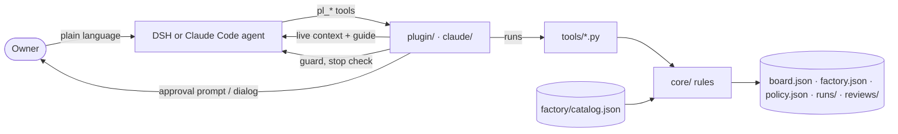

# Architecture

- **`plugin/`** is the only part that knows DeepSeek Harness. `index.mjs` wires the services; `lib/context.mjs` builds the `<polier>` block and the guide, `lib/guard.mjs` the write and command guard and the stop check, `lib/tools.mjs` the `pl_*` tools, `lib/session.mjs` roles and claims, `lib/factory.mjs` a read-only view of the line.
- **`claude/`** is the Claude Code adapter, with no code of its own for a rule or a tool. `server.mjs` serves the plugin's `pl_*` tools over MCP (stdio) and turns owner decisions into MCP elicitation dialogs; it holds the session state (mode, role, bound task, claims) per Claude Code session and subagent and lends it read-only to the hooks over a local socket. `hook.mjs` answers the hooks: live context (`SessionStart`, `UserPromptSubmit`, `SubagentStart`), the guard (`PreToolUse`) and the stop check (`Stop`, `SubagentStop`), through the same `plugin/lib/` functions DSH uses. `agents/` holds one subagent per role and `.claude-plugin/` the manifest and marketplace, both generated by `scripts/claude-plugin.py`.
- **`tools/`** are command-line programs, one per rule set. The plugin calls them for every write, so a rule has one implementation; headless runs call them directly.
- **`core/`** holds the rules in Python's standard library: board validation, the state machine, gates and evidence, approvals, claims, slots, policy, the factory line.
- **Project files** are the only state. Nothing lives in a database or a service; every record is committed with the work.

Dependencies point one way: claude → plugin → tools → core → files. Every rule exists once, in `core/`: the plugin asks `tools/guard.py` before a write or a command and shows its answer.
