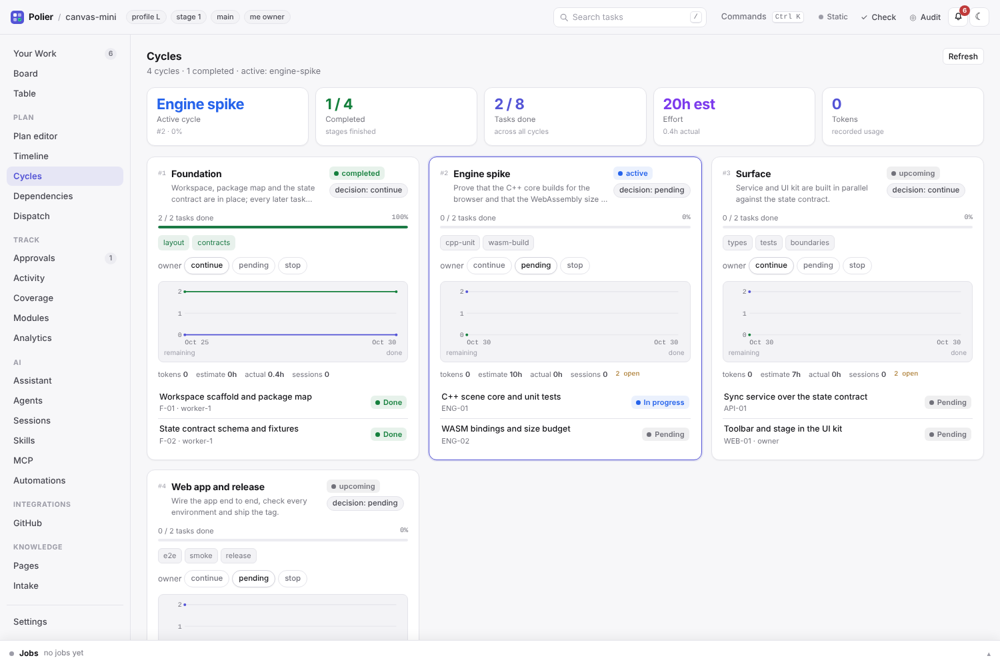
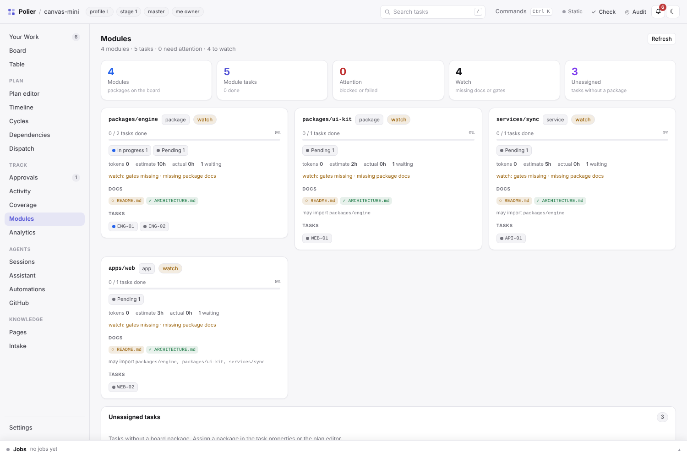
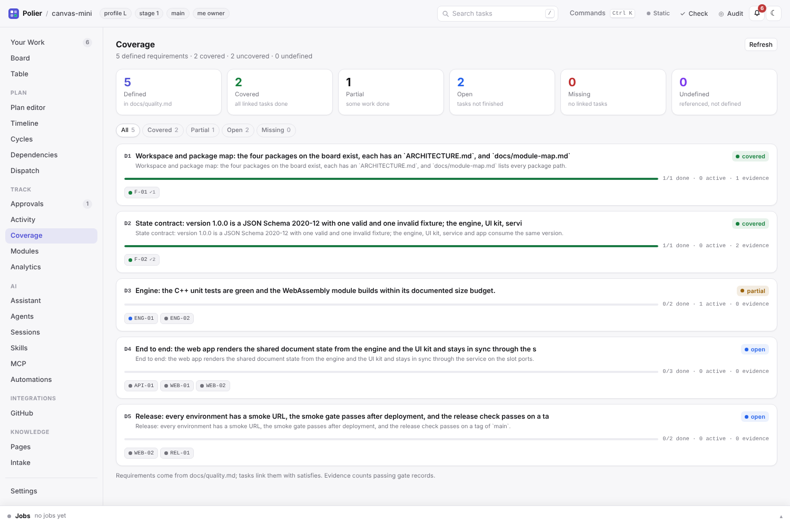

# The dashboard (2.0)

A local, zero-dependency control plane for a Polier project: one page that shows
the plan, the execution state and the decisions, and can drive the same actions
the CLI offers. It is optional — every command still works without it, the
files stay the source of truth and nothing runs in the background unless you
start it.

```bash
git clone https://github.com/atshv/Polier && cd Polier
python3 tools/serve.py /path/to/project --port 8765 --open
```

The server binds to `127.0.0.1` by default, needs Python 3.9+ only, and serves
one self-contained page from `server/assets/`. Stop it with Ctrl+C.


## What the page can do

| View | What it shows / does |
|---|---|
| Board | Kanban columns for every status (`pending`, `in_progress`, `verifying`, `review`, `rework`, `blocked`, `failed`, `done`), gate progress, tokens against the budget, live claims; table view and stage/package/owner filters |
| Task drawer | brief, gates and records, run events, review verdict, evidence logs, handoff; status transitions, claim/release, gate runs, a worker/reviewer session |
| Approvals | pending/granted/denied records; request, grant and deny with a note |
| Dispatch | next wave, running attempts, blocked tasks with reasons, scope conflicts |
| Activity | run events, gate results, reviews and approvals, newest first |
| Graph | dependency DAG as SVG (column = depth, row = stage, colour = status) |
| Sessions | start a headless agent session for a task, watch its transcript, record tokens, stop it |
| Plan | the interview wizard for a greenfield project; plan editing for an existing board (tasks, dependencies, scopes, stage decisions) |
| Jobs | gate/check/audit runs with live logs and stop buttons |


## The project cockpit (2.1)

- **Settings** (`Settings` tab) edits the committed `dashboard.json` next to `board.json`: feature flags for optional views (future views default off), the label definitions (id, title, palette colour, group) and the owner handle used by "Your Work". Machine-local settings — session provider, gate commands, theme, read state — stay in the runtime folder. The CLI is `python3 tools/settings.py show|init|feature|me|label …`.
- **Labels** are optional task fields of board schema 1.1 (`labels: [ids]`); they never change the write scope. Add or edit definitions in Settings, then assign them in the task drawer or the plan editor; the plan editor upgrades a 0.9/1.0 board to 1.1 on first use. `tools/plan.py` accepts `--labels`.
- **Filters and views**: the filter bar builds bounded conditions (field, operator, value) for text, status, label, number, boolean and budget fields. The result can be saved as a committed `views/<id>.json` with grouping, sorting and columns; built-in views ("Ready now", "Blocked", "Review queue", "Over budget", "No estimate", "Mine") come from the code and never overwrite files. CLI: `python3 tools/views.py list|builtin|show|save|delete`.
- **Your Work** (`Your Work` tab) is the owner cockpit: my tasks, review queue, approvals, claims, blocked tasks, budget warnings, ready tasks and running sessions. The **inbox** (header bell, same tab) is one actionable feed — approvals, failed gates, blocked tasks, budget, review requests, failed sessions — with a local read/unread state. Nothing is project state; only read marks are stored (runtime).
- **Worklog**: the task drawer's Worklog tab shows attempts, gate records, sessions, token usage and durations; `estimate_hours` (schema 1.1) is compared with the actual hours (session time when sessions exist, otherwise the attempt window). Project and stage sums are available from `/api/worklog` and `polier_worklog`.

## Planning views (2.2)

- **Timeline** — the plan on a time axis. `core/timeline.py` schedules tasks after their dependencies, sized from `estimate_hours` (or `complexity × 2 h`) at `dashboard.json` → `defaults.hours_per_day` (default 4), inside sequential stage lanes; completed tasks are placed at their run-record finish date. Optional board schema 1.2 fields `planned_start` and `target` (`YYYY-MM-DD`) override the auto-schedule; the plan editor, `tools/plan.py` and the task drawer's Properties set and clear them. The view draws day/week axes, a today line, the critical path, explicit-date and overdue markers and unscheduled work. `GET /api/timeline`, `polier_timeline`.
- **Cycles** — every stage as a cycle with its goal, exit criteria and exit gates, progress, owner decision, tokens/effort and a burndown built from `runs/` state events. The first incomplete stage is the active cycle; the view can set the stage decision. `GET /api/cycles`, `polier_cycles`.
- **Modules** — `packages[]` as modules: tasks and status counts, health (`ok`/`watch`/`attention`/`done`), README/ARCHITECTURE presence, contract versions, tokens and effort; tasks without a package are listed separately. `GET /api/modules`, `polier_modules`.
- **Coverage** — definitions from `docs/quality.md` (`**Dn** …`) joined with task `satisfies` and passing evidence; states `covered`/`partial`/`open`/`missing`; referenced-but-undefined requirements are reported. `GET /api/coverage`, `polier_coverage`.
- **Analytics** — completion, throughput per ISO week, cycle time per stage, gate pass rate, rework rate, blocked age, estimate vs actual effort, tokens per stage and sessions, all derived from runs, evidence and the worklog. `GET /api/analytics`, `polier_analytics`.







The five views are controlled by `dashboard.json` → `features` (default on). `defaults.hours_per_day` (1–24) changes the timeline scale. Nothing in this section writes to the project: planning dates are the only new board fields, and they are edited through the validated plan editor.

## Knowledge and intake (2.3)

- **Pages** — a read-only browser for the project's Markdown: root documents (`README`, `AGENTS`, `ARCHITECTURE`, `STATUS`, `CHANGELOG`, …), `docs/**` (with subcollections such as `docs/adr`, `docs/gates`, `docs/research`), `tasks/*.md` briefs, `reviews/*.md`, and the package/service/app/tool README/ARCHITECTURE files. A page shows its rendered content, safe relative links, backlinks (pages and tasks that reference it), the git history and old revisions (`?ref=<commit>`), plus local favorites. Full-text search covers every indexed page. Nothing is written — documents are edited by the agents through the normal write guard. `GET /api/pages`, `/api/page?path=&ref=`, `/api/page/history`, `/api/pages/search`, `/api/pages/favorites`; MCP `polier_pages`, `polier_page`, `polier_pages_search`; CLI `tools/pages.py list|search|show|history|favorite|favorites`.
- **Intake** — proposals as committed `intake/<id>.json` files in a small lifecycle: `proposed` → `accepted` (creates a pending board task through the validated plan editor and links back) or `rejected` (with a reason). Kind (`idea`/`issue`/`request`/`question`), priority, source (`owner`/`agent`/`cli`/`mcp`/`web`) and links are part of the record. Accept an entry from the intake view, the CLI (`tools/intake.py accept`) or the API; a task template can provide the structure. `GET/POST /api/intake`, `PATCH /api/intake/<id>`, `POST /api/intake/<id>/accept|reject`; MCP `polier_intake`, `polier_intake_add`.
- **Task templates** — committed `templates/tasks/<id>.json` files with the reusable shape of a task (title/goal optional, scope, acceptance, gates, complexity, labels, estimate, owner, package, exclusive). Create them by hand, save one from an existing task ("save as template"), and use them as defaults in the plan editor, the intake accept form, `POST /api/plan/tasks` (`template: <id>`) and the CLI (`tools/templates.py`). They never bypass validation. `GET/POST /api/task-templates`, `DELETE /api/task-templates/<id>`; MCP `polier_templates`.


The pages view and intake are controlled by `dashboard.json` → `features.pages` / `features.intake` (default on). Favorites are local; intake entries and templates are committed.

## Intelligence (2.4)

- **Assistant** — a read-only chat over the project's own state. `core/assistant.py` builds a compact briefing (project, stages, next wave, blocked tasks, approvals, claims, sessions, intake, task list); `server/assistant.py` runs one headless provider session per question and stores the conversation in the dashboard runtime. Answers may carry structured **proposals** (`state`, `plan_task`, `gate`, `session`, `note`); the UI applies one only after confirmation via `POST /api/assistant/apply`, which dispatches to the validated state machine, plan editor, gate job or session starter. The assistant cannot write files by itself. CLI `tools/assistant.py ask|list|show|delete`.
- **Automations** — committed `automations.json` rules with a `when` kind (`gate_failed`, `task_blocked`, `budget_over`, `review_ready`, `session_failed`, `intake_proposed`, `stage_decision_pending`, `task_ready`) and suggested actions (`state`, `session`, `open`, `note`). `core/automations.py` evaluates on demand as a **dry run**: it returns matches and suggestions, changes nothing; applying a suggestion happens in the UI through the normal validated API. `GET/PUT /api/automations`, `POST /api/automations/run`; CLI `tools/automations.py`; example rules in `templates/automations.json`.
- **Bulk operations** — `POST /api/bulk` applies `state`, `claim`, `release`, `labels` or `estimate` to up to 100 tasks and returns a per-task result (invalid transitions are reported, not hidden); the UI's board/table get multi-select and a bulk bar. All writes go through the same core functions and the audit trail.
- **Command palette** — Cmd/Ctrl+K in the UI: every view, the current tasks and quick actions (new task, new intake, ask the assistant, run automations, refresh, settings).
- **GitHub/CI** — `core/github.py` lists open PRs and recent workflow runs through the authenticated `gh` CLI and maps them to tasks by branch (`task/<ID>` or the task's branch), cached for 30 s. Without a GitHub remote, `gh` or auth the panel says why; nothing fails and no credentials are stored. `GET /api/github`, MCP `polier_github`, CLI `tools/github.py status`.


All three features are controlled by `dashboard.json` → `features.assistant` / `features.automations` / `features.github` (default on). Assistant conversations are local runtime files; automation rules are committed; the GitHub panel is read-only.

Reading the page without live updates: add `?noevents=1` (static mode) and
`?theme=light|dark` to freeze the theme; deep links are `#/board`, `#/table`,
`#/graph`, `#/dispatch`, `#/approvals`, `#/activity`, `#/sessions`, `#/plan`
and `#/board/<ID>` to open a task.

The page is read-only when you pass `--read-only` (or `--role viewer`); the
badge in the header shows it.

## Connecting your own Claude Code

The dashboard can drive headless sessions itself, and it can also let your
normal Claude Code session see the board through MCP.

**MCP (recommended first step).** Add the server to Claude Code:

```bash
claude mcp add polier -- python3 /path/to/Polier/tools/mcp.py --root /path/to/project
```

The tools are `polier_snapshot`, `polier_tasks`, `polier_task`,
`polier_dispatch`, `polier_show`, `polier_activity`, `polier_approvals`,
`polier_claims` (read) and `polier_state_set`, `polier_gate`, `polier_claim`,
`polier_release` (write; refused with `--read-only`). This is the smallest
integration: your interactive session stays your session, and the board is one
tool call away.

**Headless sessions.** The dashboard starts a provider command for a task in
the project (or in a fresh worktree) and streams its JSON events into the
session console:

```
python3 tools/session.py run M03 --role worker [--worktree] [--note "…"]
python3 tools/session.py list|show|stop …
```

Provider settings live in the dashboard config (see below). The default is the
Claude Code CLI in non-interactive mode:

```
claude -p --output-format stream-json --verbose --permission-mode acceptEdits \
  --allowedTools "Bash Read Write Edit Glob Grep TodoWrite" \
  --settings <generated settings.json> "<composed prompt>"
```

The generated settings file installs the shipped hooks
(`adapters/claude-code/hook.py`) with `POLIER_ROLE` and `POLIER_TASK` in the
environment, so a headless run is guarded like an interactive one: writes
outside the task scope are denied, the stop check runs, denied commands are
refused. The session records the token use reported by the provider in
`runs/<ID>.json`; a task with a running session keeps its claim until the run
ends.

Roles: `worker` (implements the task), `reviewer` (writes `reviews/<ID>.md`
with a `verdict:` line), `lead` (runs gates and status changes), `generator`
(the planning session below).

**Security.** Sessions run arbitrary agent commands in your project; they are
started explicitly by you from the dashboard or the CLI, with the same hooks and
scope rules as an interactive session. The dashboard itself binds to loopback,
needs the `X-Polier-Action: 1` header for writes, rejects cross-origin writes and
can require a bearer token:

```bash
POLIER_DASHBOARD_TOKEN=… python3 tools/serve.py . --port 8765
```

Never expose the dashboard to a network without a token and a reverse proxy.

## The interview wizard and plan editing

For a project without `board.json`, the page offers **Plan a project**: the
Phase-A questions (mode, name, goal, stack, hosting, …) as a form. Saving writes
a draft into the runtime folder; **Generate plan** composes
`prompt/generator.md` plus the answers into one prompt and starts a generator
session (no interactive questions are possible in a headless run — missing
answers become `open_questions` on the board). When the session has written
`ARCHITECTURE.md`, `board.json`, `tasks/` and `policy.json`, **Approve plan**
validates the board and records that you accepted it.

For an existing project the Plan view edits the board through the same rules as
the CLI: create, edit and delete tasks (only `pending`/`blocked`/`failed` tasks
can be deleted, done tasks are reopened through the state machine first), change
dependencies (cycles are refused), scopes, gates, stages and owner decisions.
`board.json` is written atomically under `board.json.lock` and validated with
`core.board.board_errors` before it is replaced.

## API

All routes return JSON. Mutations need `X-Polier-Action: 1`; with a token, send
`Authorization: Bearer <token>` (or `?token=`). Errors have the shape
`{"error": "…", "details": …}`; a refused state transition answers `409` with
the `errors`/`actions` the CLI would print.

| Method and path | Purpose |
|---|---|
| `GET /api/health` | version, role, board presence |
| `GET /api/config` | dashboard config, suggested gate commands, session settings |
| `GET /api/snapshot` | whole project: tasks with derived fields, dispatch, stages, counts, git |
| `GET /api/tasks/<id>` | task detail: brief, review, gate records, events, approvals |
| `GET /api/tasks/<id>/logs/<log>` | one gate log from `reviews/evidence/` |
| `GET /api/dispatch`, `/api/activity`, `/api/approvals`, `/api/claims` | plan, feed, decisions, live claims |
| `POST /api/tasks/<id>/state` | lead-only status transition (`status`, `note`, `force`) |
| `POST/DELETE /api/tasks/<id>/claim` | take/release the claim |
| `POST /api/approvals/request`, `/api/approvals/<id>/grant\|deny` | owner decisions |
| `POST /api/jobs/gate`, `/api/jobs/check`, `/api/jobs/audit` | start a streaming job |
| `GET /api/jobs`, `/api/jobs/<id>`, `/api/jobs/<id>/log`, `POST /api/jobs/<id>/stop` | jobs and live logs |
| `POST /api/sessions`, `GET /api/sessions`, `/api/sessions/<id>/log`, `POST /api/sessions/<id>/stop` | headless sessions |
| `GET/PUT /api/plan`, `POST /api/plan/answers` | interview draft |
| `POST /api/plan/generator`, `/api/plan/approve` | planning session, approval |
| `POST /api/plan/tasks`, `PATCH/DELETE /api/plan/tasks/<id>` | plan editing |
| `POST /api/plan/stages/<id>/decision`, `/move` | stage owner decision, order |
| `GET/PUT /api/settings`, `POST /api/settings/labels`, `PUT/DELETE /api/settings/labels/<id>` | project settings, feature flags, labels |
| `GET /api/filters/fields` | filter field/operator metadata for the builder |
| `GET /api/views`, `PUT/DELETE /api/views/<id>` | built-in and saved views |
| `GET /api/worklog[?task=<id>]` | per-task or project worklog and estimate comparison |
| `GET /api/me`, `GET /api/inbox`, `POST /api/inbox/read` | Your Work, inbox items and read state |
| `GET /api/timeline` | dependency- and estimate-based schedule, lanes, critical path, dates |
| `GET /api/cycles` | stages as cycles: progress, exit gates, decision, burndown, effort |
| `GET /api/modules` | packages with tasks, health, docs and contracts |
| `GET /api/coverage` | requirement definitions, task links, evidence and gaps |
| `GET /api/analytics` | throughput, cycle time, gate pass rate, rework, effort and tokens |
| `GET /api/pages`, `/api/page?path=&ref=`, `/api/page/history`, `/api/pages/search`, `PUT /api/pages/favorites` | Markdown knowledge layer: collections, content, revisions, search, favorites |
| `GET/POST /api/intake`, `PATCH /api/intake/<id>`, `POST /api/intake/<id>/accept\|reject` | intake proposals and triage into validated tasks |
| `GET/POST /api/task-templates`, `DELETE /api/task-templates/<id>` | reusable task templates |
| `GET/POST /api/assistant`, `/api/assistant/chat`, `/api/assistant/<id>`, `/api/assistant/apply` | read-only assistant conversations and validated proposal application |
| `GET/PUT /api/automations`, `POST /api/automations/run` | deterministic rules and their dry-run matches |
| `POST /api/bulk` | bulk state/claim/release/labels/estimate with per-task results |
| `GET /api/github` | read-only PRs, CI runs and task-to-branch mapping via `gh` |
| `GET /api/events` | Server-Sent Events (`state`, `job`, `session`, `approval`, `claim`, `plan`, `inbox`, `views`, `settings`, `ready`, `lag`) |

The dashboard also reads gate commands from the project's own table in
`docs/quality.md` (columns: gate, command) so the gate runner prefills the
documented command. Saved overrides live in the dashboard config.

## Configuration and runtime files

Nothing of the dashboard is committed. Runtime files live in
`<git-common-dir>/polier/dashboard/` (shared by all worktrees; outside git the
page falls back to `.polier-dashboard/`):

| Path | Contents |
|---|---|
| `dashboard.json` (project root, committed) | feature flags, label definitions, defaults (`me`, `hours_per_day`) |
| `views/<id>.json` (project root, committed) | saved filters, grouping, sorting and columns |
| `intake/<id>.json` (project root, committed) | intake proposals and their decisions |
| `templates/tasks/<id>.json` (project root, committed) | reusable task templates |
| `automations.json` (project root, committed) | deterministic automation rules (evaluated as a dry run) |
| `config.json` (runtime) | provider command/settings, gate-command overrides, UI preferences |
| `plan.json`, `plan/` | interview answers and the last generator prompt |
| `jobs/<id>.log` | full output of gate/check/audit jobs |
| `sessions/<id>/` | prompt, generated Claude settings, transcript, session log, meta |
| `inbox.json` | read state of the inbox items |
| `pages.json` | local page favorites |
| `assistant/<id>.json` | local assistant conversations |

Deleting the folder loses transcripts, job logs and read marks only; `dashboard.json` and `views/` are project files and survive.

## Limits and design notes

- The server is a local operator tool, not a hosted service: one project per
  process, no authentication beyond the optional token, no multi-user roles.
- It calls the same `core` functions as the CLI; it never re-implements the
  state machine, the policy or the evidence rules. `board.json` is never written
  by the server except through `core.state.set_status` and the validated plan
  editor.
- `STATUS.html` from `render_status.py --html` stays the zero-server page for
  archives and CI. The dashboard is for the working session.
- Sessions are opt-in and provider-specific. Only the Claude Code CLI defaults
  are shipped; a custom provider is a command list in the config (tests use a
  fake provider). The adapter layer stays thin because CLI flags and event
  formats change.
- Headless runs inherit the local Claude Code login; token use is recorded but
  cost control remains `policy.json` → `budget`.
- "Worklog actual hours" are derived, not tracked: an attempt window or the
  session span. It is a comparison aid for estimates, not payroll time.
- The inbox is a derived feed, not a store; only its read marks are local.
- Pages are read-only: the viewer never edits a document, and old revisions are
  read from git. Intake, task templates and automation rules are the committed
  additions; the assistant never writes and only proposes validated actions.
- Automations are suggestions, not a daemon: nothing runs in the background and
  a dry run changes no project file.
- The GitHub panel depends on the local `gh` login; it is read-only and caches for
  30 seconds.
- The timeline is a derived schedule unless `planned_start`/`target` are set; it
  is a planning aid, not a promise. Cycles are stages by evidence, not calendar
  periods, and Coverage only knows the D-codes the project documents.
